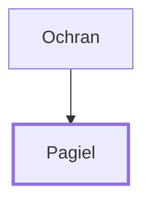

# Pagiel

Leader of the tribe of Asher

**Original-language names:** פַּגְעִיאֵל (H6295)

## When

- **Placed around:** [[connections/timeline/15th century BC|1490 BC]] *(Ussher: the median date of the passages naming them)*

## Family

- **Father:** [[connections/people/Ochran|Ochran]]
- **Tribe or nation:** Tribe of Asher

**Family group:** [[connections/genealogy/Family of Ochran|Family of Ochran]], generation 2

## Appears in

[[connections/chapters/04-numbers/Numbers 1|Numbers 1]] · [[connections/chapters/04-numbers/Numbers 2|Numbers 2]] · [[connections/chapters/04-numbers/Numbers 7|Numbers 7 (2)]] · [[connections/chapters/04-numbers/Numbers 10|Numbers 10]]

## Appears in the same verse as

[[connections/people/Ochran|Ochran (5)]] · [[connections/people/Asher|Asher (4)]]
