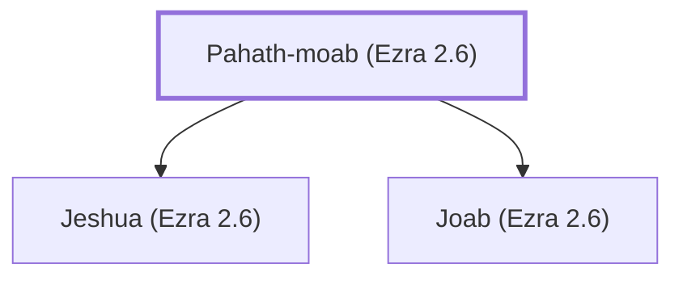

# Pahath-moab (Ezra 2.6)

Group of returnees from Babylonian exile

**Original-language names:** פַּ֫חַת מוֹאָב (H6355)

## When

- **Placed around:** [[connections/timeline/5th century BC|456 BC]] *(Ussher: the median date of the passages naming them)*

## Family

- **Children:** [[connections/people/Jeshua (Ezra 2.6)|Jeshua (Ezra 2.6)]], [[connections/people/Joab (Ezra 2.6)|Joab (Ezra 2.6)]]

**Family group:** [[connections/genealogy/Family of Pahath-moab (Ezra 2.6)|Family of Pahath-moab (Ezra 2.6)]], generation 1

## Appears in

[[connections/chapters/15-ezra/Ezra 2|Ezra 2]] · [[connections/chapters/15-ezra/Ezra 8|Ezra 8]] · [[connections/chapters/15-ezra/Ezra 10|Ezra 10]] · [[connections/chapters/16-nehemiah/Nehemiah 7|Nehemiah 7]]

## Appears in the same verse as

[[connections/people/Jeshua (Ezra 2.6)|Jeshua (Ezra 2.6) (2)]] · [[connections/people/Joab (Ezra 2.6)|Joab (Ezra 2.6) (2)]] · [[connections/people/Adna (Ezra 10.30)|Adna (Ezra 10.30)]] · [[connections/people/Benaiah (Ezra 10.30)|Benaiah (Ezra 10.30)]] · [[connections/people/Bezalel (Ezra 10.30)|Bezalel (Ezra 10.30)]] · [[connections/people/Binnui (Ezra 10.30)|Binnui (Ezra 10.30)]] · [[connections/people/Chelal|Chelal]] · [[connections/people/Eliehoenai (Ezra 8.4)|Eliehoenai (Ezra 8.4)]] · [[connections/people/Maaseiah (Ezra 10.30)|Maaseiah (Ezra 10.30)]] · [[connections/people/Manasseh (Ezra 10.30)|Manasseh (Ezra 10.30)]] · [[connections/people/Mattaniah (Ezra 10.30)|Mattaniah (Ezra 10.30)]] · [[connections/people/Zerahiah (Ezra 8.4)|Zerahiah (Ezra 8.4)]]
