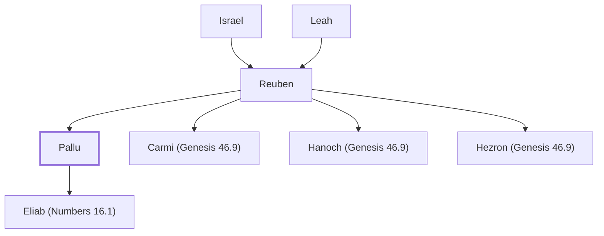

# Pallu

Son of Reuben, ancestor of the Palluites

**Original-language names:** פַּלּוּא (H6396)

## When

- **Placed around:** [[connections/timeline/15th century BC|1491 BC]] *(Ussher: the median date of the passages naming them)*

## Family

- **Father:** [[connections/people/Reuben|Reuben]]
- **Brothers and sisters:** [[connections/people/Carmi (Genesis 46.9)|Carmi (Genesis 46.9)]], [[connections/people/Hanoch (Genesis 46.9)|Hanoch (Genesis 46.9)]], [[connections/people/Hezron (Genesis 46.9)|Hezron (Genesis 46.9)]]
- **Children:** [[connections/people/Eliab (Numbers 16.1)|Eliab (Numbers 16.1)]]
- **Tribe or nation:** Tribe of Reuben

**Line of descent** (25 generations, father to son): [[connections/people/Adam|Adam]] → [[connections/people/Seth|Seth]] → [[connections/people/Enosh|Enosh]] → [[connections/people/Kenan|Kenan]] → [[connections/people/Mahalalel (Genesis 5.12)|Mahalalel (Genesis 5.12)]] → [[connections/people/Jared|Jared]] → [[connections/people/Enoch (Genesis 5.18)|Enoch (Genesis 5.18)]] → [[connections/people/Methuselah|Methuselah]] → [[connections/people/Lamech (Genesis 5.25)|Lamech (Genesis 5.25)]] → [[connections/people/Noah (Genesis 5.29)|Noah (Genesis 5.29)]] → [[connections/people/Shem|Shem]] → [[connections/people/Arpachshad|Arpachshad]] → [[connections/people/Cainan|Cainan]] → [[connections/people/Shelah (Genesis 10.24)|Shelah (Genesis 10.24)]] → [[connections/people/Eber (Genesis 10.21)|Eber (Genesis 10.21)]] → [[connections/people/Peleg|Peleg]] → [[connections/people/Reu|Reu]] → [[connections/people/Serug|Serug]] → [[connections/people/Nahor (Genesis 11.22)|Nahor (Genesis 11.22)]] → [[connections/people/Terah|Terah]] → [[connections/people/Abraham|Abraham]] → [[connections/people/Isaac|Isaac]] → [[connections/people/Israel|Israel]] → [[connections/people/Reuben|Reuben]] → **Pallu**

**Family group:** [[connections/genealogy/Family of Adam|Family of Adam]], generation 25

## Appears in

[[connections/chapters/01-genesis/Genesis 46|Genesis 46]] · [[connections/chapters/02-exodus/Exodus 6|Exodus 6]] · [[connections/chapters/04-numbers/Numbers 26|Numbers 26 (2)]] · [[connections/chapters/13-1-chronicles/1 Chronicles 5|1 Chronicles 5]]

## Appears in the same verse as

[[connections/people/Hanoch (Genesis 46.9)|Hanoch (Genesis 46.9) (4)]] · [[connections/people/Reuben|Reuben (4)]] · [[connections/people/Carmi (Genesis 46.9)|Carmi (Genesis 46.9) (3)]] · [[connections/people/Hezron (Genesis 46.9)|Hezron (Genesis 46.9) (3)]] · [[connections/people/Israel|Israel (3)]] · [[connections/people/Eliab (Numbers 16.1)|Eliab (Numbers 16.1)]]
