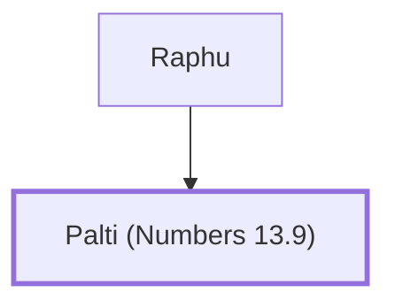

# Palti (Numbers 13.9)

Son of Raphu, spy from Benjamin

**Original-language names:** פַּלְטִי (H6406)

## When

- **Placed around:** [[connections/timeline/15th century BC|1490 BC]] *(Ussher: the median date of the passages naming them)*

## Family

- **Father:** [[connections/people/Raphu|Raphu]]

**Family group:** [[connections/genealogy/Family of Raphu|Family of Raphu]], generation 2

## Appears in

[[connections/chapters/04-numbers/Numbers 13|Numbers 13]]

## Appears in the same verse as

[[connections/people/Benjamin (Genesis 35.18)|Benjamin (Genesis 35.18)]] · [[connections/people/Raphu|Raphu]]
