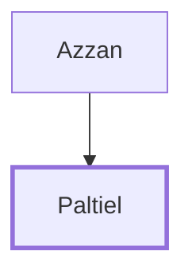

# Paltiel

Leader from Issachar, helped divide Canaan

**Original-language names:** פַּלְטִיאֵל (H6409)

## When

- **Placed around:** [[connections/timeline/15th century BC|1452 BC]] *(Ussher: the median date of the passages naming them)*

## Family

- **Father:** [[connections/people/Azzan|Azzan]]

**Family group:** [[connections/genealogy/Family of Azzan|Family of Azzan]], generation 2

## Appears in

[[connections/chapters/04-numbers/Numbers 34|Numbers 34]]

## Appears in the same verse as

[[connections/people/Azzan|Azzan]] · [[connections/people/Issachar (Genesis 30.18)|Issachar (Genesis 30.18)]]
