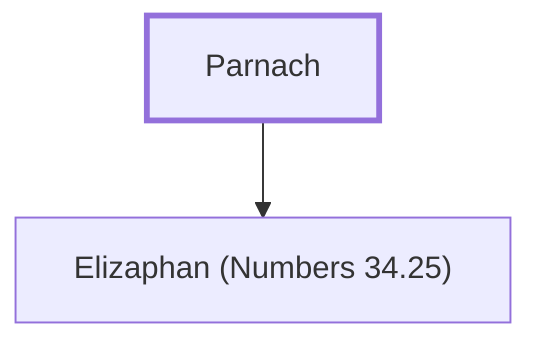

# Parnach

Father of Elizaphan, leader from Zebulun

**Original-language names:** פַּרְנָךְ (H6535)

## When

- **Placed around:** [[connections/timeline/15th century BC|1452 BC]] *(Ussher: the median date of the passages naming them)*

## Family

- **Children:** [[connections/people/Elizaphan (Numbers 34.25)|Elizaphan (Numbers 34.25)]]

**Family group:** [[connections/genealogy/Family of Parnach|Family of Parnach]], generation 1

## Appears in

[[connections/chapters/04-numbers/Numbers 34|Numbers 34]]

## Appears in the same verse as

[[connections/people/Elizaphan (Numbers 34.25)|Elizaphan (Numbers 34.25)]] · [[connections/people/Zebulun|Zebulun]]
