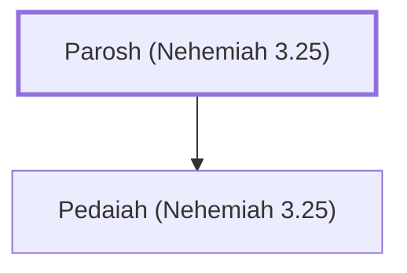

# Parosh (Nehemiah 3.25)

A man involved in repairing Jerusalem's wall

**Original-language names:** פַּרְעֹשׁ (H6551)

## When

- **Placed around:** [[connections/timeline/5th century BC|445 BC]] *(Ussher: the median date of the passages naming them)*

## Family

- **Children:** [[connections/people/Pedaiah (Nehemiah 3.25)|Pedaiah (Nehemiah 3.25)]]

**Family group:** [[connections/genealogy/Family of Parosh (Nehemiah 3.25)|Family of Parosh (Nehemiah 3.25)]], generation 1

## Appears in

[[connections/chapters/16-nehemiah/Nehemiah 3|Nehemiah 3]]

## Appears in the same verse as

[[connections/people/Palal|Palal]] · [[connections/people/Pedaiah (Nehemiah 3.25)|Pedaiah (Nehemiah 3.25)]] · [[connections/people/Uzai|Uzai]]
