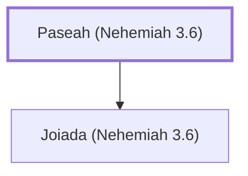

# Paseah (Nehemiah 3.6)

Father of Joiada, who repaired the Old Gate

**Original-language names:** פָּסֵחַ (H6454)

## When

- **Placed around:** [[connections/timeline/5th century BC|445 BC]] *(Ussher: the median date of the passages naming them)*

## Family

- **Children:** [[connections/people/Joiada (Nehemiah 3.6)|Joiada (Nehemiah 3.6)]]

**Family group:** [[connections/genealogy/Family of Paseah (Nehemiah 3.6)|Family of Paseah (Nehemiah 3.6)]], generation 1

## Appears in

[[connections/chapters/16-nehemiah/Nehemiah 3|Nehemiah 3]]

## Appears in the same verse as

[[connections/people/Besodeiah|Besodeiah]] · [[connections/people/Joiada (Nehemiah 3.6)|Joiada (Nehemiah 3.6)]] · [[connections/people/Meshullam (Nehemiah 3.6)|Meshullam (Nehemiah 3.6)]] · [[connections/places/Yeshanah Gate|Yeshanah Gate]]
