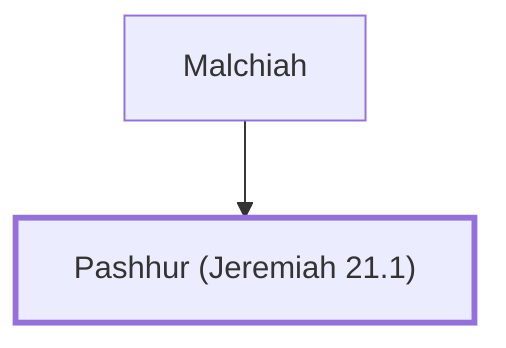

# Pashhur (Jeremiah 21.1)

Priest sent by Zedekiah to inquire of Jeremiah

**Original-language names:** פַּשְׁחוּר (H6583)

## When

- **Placed around:** [[connections/timeline/6th century BC|589 BC]] *(Ussher: the median date of the passages naming them)*

## Family

- **Father:** [[connections/people/Malchiah|Malchiah]]
- **Tribe or nation:** Tribe of Benjamin

**Family group:** [[connections/genealogy/Family of Malchiah|Family of Malchiah]], generation 2

## Appears in

[[connections/chapters/24-jeremiah/Jeremiah 21|Jeremiah 21]] · [[connections/chapters/24-jeremiah/Jeremiah 38|Jeremiah 38]]

## Appears in the same verse as

[[connections/people/Jeremiah (2 Chronicles 35.25)|Jeremiah (2 Chronicles 35.25) (2)]] · [[connections/people/Malchiah|Malchiah (2)]] · [[connections/people/Gedaliah (Jeremiah 38.1)|Gedaliah (Jeremiah 38.1)]] · [[connections/people/Jehucal|Jehucal]] · [[connections/people/Maaseiah (Jeremiah 21.1)|Maaseiah (Jeremiah 21.1)]] · [[connections/people/Mattan (Jeremiah 38.1)|Mattan (Jeremiah 38.1)]] · [[connections/people/Pashhur (Jeremiah 38.1)|Pashhur (Jeremiah 38.1)]] · [[connections/people/Shelemiah (Jeremiah 37.3)|Shelemiah (Jeremiah 37.3)]] · [[connections/people/Shephatiah (Jeremiah 38.1)|Shephatiah (Jeremiah 38.1)]] · [[connections/people/Zedekiah (2 Kings 24.17)|Zedekiah (2 Kings 24.17)]] · [[connections/people/Zephaniah (2 Kings 25.18)|Zephaniah (2 Kings 25.18)]]
