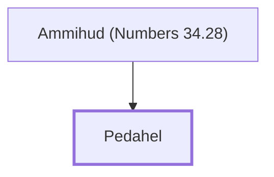

# Pedahel

Leader from Naphtali appointed to divide Canaan

**Original-language names:** פְּדַהְאֵל (H6300)

## When

- **Placed around:** [[connections/timeline/15th century BC|1452 BC]] *(Ussher: the median date of the passages naming them)*

## Family

- **Father:** [[connections/people/Ammihud (Numbers 34.28)|Ammihud (Numbers 34.28)]]

**Family group:** [[connections/genealogy/Family of Ammihud (Numbers 34.28)|Family of Ammihud (Numbers 34.28)]], generation 2

## Appears in

[[connections/chapters/04-numbers/Numbers 34|Numbers 34]]

## Appears in the same verse as

[[connections/people/Ammihud (Numbers 34.28)|Ammihud (Numbers 34.28)]] · [[connections/people/Naphtali|Naphtali]]
