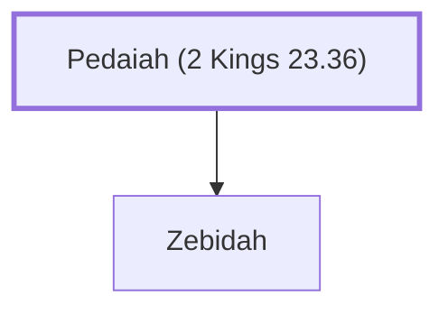

# Pedaiah (2 Kings 23.36)

Father of Zebidah, mother of King Jehoiakim

**Original-language names:** פְּדָיָהוּ (H6305)

## When

- **Placed around:** [[connections/timeline/7th century BC|610 BC]] *(Ussher: the median date of the passages naming them)*

## Family

- **Children:** [[connections/people/Zebidah|Zebidah]]

**Family group:** [[connections/genealogy/Family of Adam|Family of Adam]], generation 1

## Appears in

[[connections/chapters/12-2-kings/2 Kings 23|2 Kings 23]]

## Appears in the same verse as

[[connections/people/Jehoiakim|Jehoiakim]] · [[connections/people/Zebidah|Zebidah]] · [[connections/places/Arumah|Arumah]] · [[connections/places/Jerusalem|Jerusalem]]
