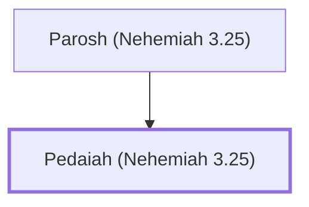

# Pedaiah (Nehemiah 3.25)

Father of a man who repaired Jerusalem's wall

**Original-language names:** פְּדָיָהוּ (H6305)

## When

- **Placed around:** [[connections/timeline/5th century BC|445 BC]] *(Ussher: the median date of the passages naming them)*

## Family

- **Father:** [[connections/people/Parosh (Nehemiah 3.25)|Parosh (Nehemiah 3.25)]]

**Family group:** [[connections/genealogy/Family of Parosh (Nehemiah 3.25)|Family of Parosh (Nehemiah 3.25)]], generation 2

## Appears in

[[connections/chapters/16-nehemiah/Nehemiah 3|Nehemiah 3]]

## Appears in the same verse as

[[connections/people/Palal|Palal]] · [[connections/people/Parosh (Nehemiah 3.25)|Parosh (Nehemiah 3.25)]] · [[connections/people/Uzai|Uzai]]
