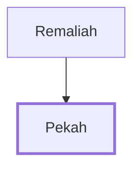

# Pekah

King of Israel who reigned for 20 years

**Original-language names:** פֶּ֫קַח (H6492)

## When

- **Placed around:** [[connections/timeline/8th century BC|742 BC]] *(Ussher: the median date of the passages naming them)*

## Family

- **Father:** [[connections/people/Remaliah|Remaliah]]
- **Tribe or nation:** Israel

**Family group:** [[connections/genealogy/Family of Remaliah|Family of Remaliah]], generation 2

## Events

- [[connections/timeline/8th century BC|759 BC]] · [[connections/events/Death of Pekahiah|Death of Pekahiah]]
- [[connections/timeline/8th century BC|759 BC]] · [[connections/events/Reign of Pekah|Reign of Pekah]]
- [[connections/timeline/8th century BC|739 BC]] · [[connections/events/Death of Pekah|Death of Pekah]]

## Appears in

[[connections/chapters/12-2-kings/2 Kings 15|2 Kings 15 (7)]] · [[connections/chapters/12-2-kings/2 Kings 16|2 Kings 16 (2)]] · [[connections/chapters/14-2-chronicles/2 Chronicles 28|2 Chronicles 28]] · [[connections/chapters/23-isaiah/Isaiah 7|Isaiah 7]]

## Appears in the same verse as

[[connections/people/Remaliah|Remaliah (9)]] · [[connections/people/Israel|Israel (6)]] · [[connections/people/Judah (Genesis 29.35)|Judah (Genesis 29.35) (6)]] · [[connections/people/Jotham (2 Kings 15.5)|Jotham (2 Kings 15.5) (4)]] · [[connections/people/Uzziah (2 Kings 14.21)|Uzziah (2 Kings 14.21) (4)]] · [[connections/people/Ahaz (2 Kings 15.38)|Ahaz (2 Kings 15.38) (3)]] · [[connections/people/Rezin (2 Kings 15.37)|Rezin (2 Kings 15.37) (3)]] · [[connections/places/Syria|Syria (3)]] · [[connections/places/Jerusalem|Jerusalem (2)]] · [[connections/places/Samaria|Samaria (2)]] · [[connections/people/Argob|Argob]] · [[connections/people/Arieh|Arieh]] · [[connections/people/Elah (2 Kings 15.30)|Elah (2 Kings 15.30)]] · [[connections/people/Hoshea (2 Kings 15.30)|Hoshea (2 Kings 15.30)]] · [[connections/people/Naphtali|Naphtali]] · [[connections/people/Tiglath-pileser|Tiglath-pileser]] · [[connections/places/Abel-beth-maacah|Abel-beth-maacah]] · [[connections/places/Assyria|Assyria]] · [[connections/places/Galilee|Galilee]] · [[connections/places/Gilead|Gilead]] · [[connections/places/Hazor (Joshua 11.1)|Hazor (Joshua 11.1)]] · [[connections/places/Ijon|Ijon]] · [[connections/places/Janoah (2 Kings 15.29)|Janoah (2 Kings 15.29)]] · [[connections/places/Kedesh|Kedesh]]
