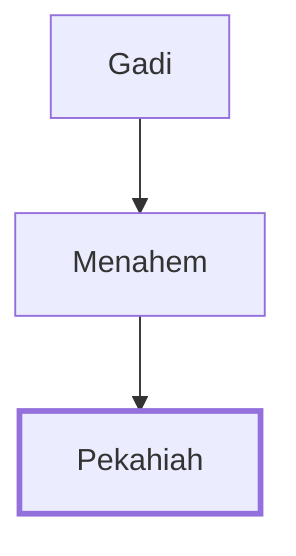

# Pekahiah

King of Israel who reigned for 2 years

**Original-language names:** פְּקַחְיָה (H6494)

## When

- **Placed around:** [[connections/timeline/8th century BC|761 BC]] *(Ussher: the median date of the passages naming them)*

## Family

- **Father:** [[connections/people/Menahem|Menahem]]
- **Tribe or nation:** Israel

**Line of descent** (3 generations, father to son): [[connections/people/Gadi|Gadi]] → [[connections/people/Menahem|Menahem]] → **Pekahiah**

**Family group:** [[connections/genealogy/Family of Gadi|Family of Gadi]], generation 3

## Events

- [[connections/timeline/8th century BC|761 BC]] · [[connections/events/Reign of Pekahiah|Reign of Pekahiah]]
- [[connections/timeline/8th century BC|759 BC]] · [[connections/events/Death of Pekahiah|Death of Pekahiah]]

## Appears in

[[connections/chapters/12-2-kings/2 Kings 15|2 Kings 15 (3)]]

## Appears in the same verse as

[[connections/people/Israel|Israel (2)]] · [[connections/people/Menahem|Menahem (2)]] · [[connections/people/Judah (Genesis 29.35)|Judah (Genesis 29.35)]] · [[connections/people/Uzziah (2 Kings 14.21)|Uzziah (2 Kings 14.21)]] · [[connections/places/Samaria|Samaria]]
