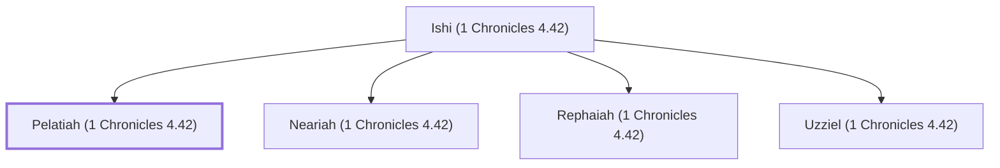

# Pelatiah (1 Chronicles 4.42)

Simeonite leader who attacked the Amalekites

**Original-language names:** פְּלַטְיָ֫הוּ (H6410)

## When

- **Placed around:** [[connections/timeline/18th century BC|1721 BC]] *(Ussher: the median date of the passages naming them)*

## Family

- **Father:** [[connections/people/Ishi (1 Chronicles 4.42)|Ishi (1 Chronicles 4.42)]]
- **Brothers and sisters:** [[connections/people/Neariah (1 Chronicles 4.42)|Neariah (1 Chronicles 4.42)]], [[connections/people/Rephaiah (1 Chronicles 4.42)|Rephaiah (1 Chronicles 4.42)]], [[connections/people/Uzziel (1 Chronicles 4.42)|Uzziel (1 Chronicles 4.42)]]
- **Tribe or nation:** Tribe of Simeon

**Family group:** [[connections/genealogy/Family of Ishi (1 Chronicles 4.42)|Family of Ishi (1 Chronicles 4.42)]], generation 2

## Appears in

[[connections/chapters/13-1-chronicles/1 Chronicles 4|1 Chronicles 4]]

## Appears in the same verse as

[[connections/people/Ishi (1 Chronicles 4.42)|Ishi (1 Chronicles 4.42)]] · [[connections/people/Neariah (1 Chronicles 4.42)|Neariah (1 Chronicles 4.42)]] · [[connections/people/Rephaiah (1 Chronicles 4.42)|Rephaiah (1 Chronicles 4.42)]] · [[connections/people/Simeon (Genesis 29.33)|Simeon (Genesis 29.33)]] · [[connections/people/Uzziel (1 Chronicles 4.42)|Uzziel (1 Chronicles 4.42)]] · [[connections/places/Seir Mount (Deuteronomy 1.2)|Seir Mount (Deuteronomy 1.2)]]
