# Pelet (1 Chronicles 2.47)

Son of Jahdai, descendant of Judah

**Original-language names:** פֶּ֫לֶט (H6404)

## When

- **Placed around:** [[connections/timeline/15th century BC|1470 BC]] *(Ussher: the median date of the passages naming them)*

## Family

- **Father:** [[connections/people/Caleb (1 Chronicles 2.9)|Caleb (1 Chronicles 2.9)]]
- **Mother:** [[connections/people/Jahdai|Jahdai (uncertain)]]
- **Brothers and sisters:** [[connections/people/Achsah (1 Chronicles 2.49)|Achsah (1 Chronicles 2.49) (uncertain)]], [[connections/people/Ardon|Ardon (uncertain)]], [[connections/people/Ephah (1 Chronicles 2.47)|Ephah (1 Chronicles 2.47)]], [[connections/people/Gazez (1 Chronicles 2.46)|Gazez (1 Chronicles 2.46) (uncertain)]], [[connections/people/Geshan|Geshan]], [[connections/people/Haran (1 Chronicles 2.46)|Haran (1 Chronicles 2.46) (uncertain)]], [[connections/people/Hur (Exodus 17.10)|Hur (Exodus 17.10) (uncertain)]], [[connections/people/Jesher|Jesher (uncertain)]], [[connections/people/Jotham (1 Chronicles 2.47)|Jotham (1 Chronicles 2.47)]], [[connections/people/Mesha (1 Chronicles 2.42)|Mesha (1 Chronicles 2.42) (uncertain)]], [[connections/people/Moza (1 Chronicles 2.46)|Moza (1 Chronicles 2.46) (uncertain)]], [[connections/people/Regem|Regem]], [[connections/people/Shaaph (1 Chronicles 2.47)|Shaaph (1 Chronicles 2.47)]], [[connections/people/Shaaph (1 Chronicles 2.49)|Shaaph (1 Chronicles 2.49) (uncertain)]], [[connections/people/Sheber|Sheber (uncertain)]], [[connections/people/Sheva|Sheva (uncertain)]], [[connections/people/Shobab (1 Chronicles 2.18)|Shobab (1 Chronicles 2.18) (uncertain)]], [[connections/people/Tirhanah|Tirhanah (uncertain)]]
- **Tribe or nation:** Tribe of Judah

**Line of descent** (28 generations, father to son): [[connections/people/Adam|Adam]] → [[connections/people/Seth|Seth]] → [[connections/people/Enosh|Enosh]] → [[connections/people/Kenan|Kenan]] → [[connections/people/Mahalalel (Genesis 5.12)|Mahalalel (Genesis 5.12)]] → [[connections/people/Jared|Jared]] → [[connections/people/Enoch (Genesis 5.18)|Enoch (Genesis 5.18)]] → [[connections/people/Methuselah|Methuselah]] → [[connections/people/Lamech (Genesis 5.25)|Lamech (Genesis 5.25)]] → [[connections/people/Noah (Genesis 5.29)|Noah (Genesis 5.29)]] → [[connections/people/Shem|Shem]] → [[connections/people/Arpachshad|Arpachshad]] → [[connections/people/Cainan|Cainan]] → [[connections/people/Shelah (Genesis 10.24)|Shelah (Genesis 10.24)]] → [[connections/people/Eber (Genesis 10.21)|Eber (Genesis 10.21)]] → [[connections/people/Peleg|Peleg]] → [[connections/people/Reu|Reu]] → [[connections/people/Serug|Serug]] → [[connections/people/Nahor (Genesis 11.22)|Nahor (Genesis 11.22)]] → [[connections/people/Terah|Terah]] → [[connections/people/Abraham|Abraham]] → [[connections/people/Isaac|Isaac]] → [[connections/people/Israel|Israel]] → [[connections/people/Judah (Genesis 29.35)|Judah (Genesis 29.35)]] → [[connections/people/Perez|Perez]] → [[connections/people/Hezron (Genesis 46.12)|Hezron (Genesis 46.12)]] → [[connections/people/Caleb (1 Chronicles 2.9)|Caleb (1 Chronicles 2.9)]] → **Pelet (1 Chronicles 2.47)**

**Family group:** [[connections/genealogy/Family of Adam|Family of Adam]], generation 28

```mermaid
flowchart TB
  n0["Pelet (1 Chronicles 2.47)"]:::me
  n1["Hezron (Genesis 46.12)"]
  n2["Caleb (1 Chronicles 2.9)"]
  n1 --> n2
  n3["a wife of Hezron (1 Chronicles 2.9)"]
  n3 --> n2
  n2 --> n0
  n4["Jahdai"]
  n4 --> n0
  n5["Achsah (1 Chronicles 2.49)"]
  n2 --> n5
  n6["Ardon"]
  n2 --> n6
  n7["Ephah (1 Chronicles 2.47)"]
  n2 --> n7
  n8["Gazez (1 Chronicles 2.46)"]
  n2 --> n8
  n9["Geshan"]
  n2 --> n9
  n10["Haran (1 Chronicles 2.46)"]
  n2 --> n10
  n11["Hur (Exodus 17.10)"]
  n2 --> n11
  n12["Jesher"]
  n2 --> n12
  n13["Jotham (1 Chronicles 2.47)"]
  n2 --> n13
  n14["Mesha (1 Chronicles 2.42)"]
  n2 --> n14
  n15["Moza (1 Chronicles 2.46)"]
  n2 --> n15
  n16["Regem"]
  n2 --> n16
  n17["Shaaph (1 Chronicles 2.47)"]
  n2 --> n17
  n18["Shaaph (1 Chronicles 2.49)"]
  n2 --> n18
  n19["Sheber"]
  n2 --> n19
  n20["Sheva"]
  n2 --> n20
  n21["Shobab (1 Chronicles 2.18)"]
  n2 --> n21
  n22["Tirhanah"]
  n2 --> n22
  classDef me stroke-width:3px
  classDef spouse stroke-dasharray:4
```

## Appears in

[[connections/chapters/13-1-chronicles/1 Chronicles 2|1 Chronicles 2]]

## Appears in the same verse as

[[connections/people/Ephah (1 Chronicles 2.47)|Ephah (1 Chronicles 2.47)]] · [[connections/people/Geshan|Geshan]] · [[connections/people/Jahdai|Jahdai]] · [[connections/people/Jotham (1 Chronicles 2.47)|Jotham (1 Chronicles 2.47)]] · [[connections/people/Regem|Regem]] · [[connections/people/Shaaph (1 Chronicles 2.47)|Shaaph (1 Chronicles 2.47)]]
