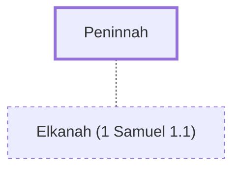

# Peninnah

Elkanah's wife, rival of Hannah

**Original-language names:** פְּנִנָּה (H6444)

## Family

- **Spouses:** [[connections/people/Elkanah (1 Samuel 1.1)|Elkanah (1 Samuel 1.1)]]

## Appears in

[[connections/chapters/09-1-samuel/1 Samuel 1|1 Samuel 1 (2)]]

## Appears in the same verse as

[[connections/people/Elkanah (1 Samuel 1.1)|Elkanah (1 Samuel 1.1)]] · [[connections/people/Hannah|Hannah]]
