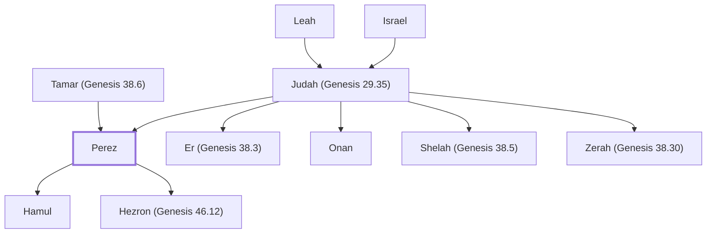

# Perez

Son of Judah, ancestor of David and Jesus

**Original-language names:** פֶּ֫רֶץ (H6557) · Φάρες (G5329)

## When

- **Lived:** [[connections/timeline/18th century BC|1721 BC]] – ? *(Jones)*
- **Placed around:** [[connections/timeline/14th century BC|1307 BC]] *(Ussher: the median date of the passages naming them)*

## Family

- **Father:** [[connections/people/Judah (Genesis 29.35)|Judah (Genesis 29.35)]]
- **Mother:** [[connections/people/Tamar (Genesis 38.6)|Tamar (Genesis 38.6)]]
- **Brothers and sisters:** [[connections/people/Er (Genesis 38.3)|Er (Genesis 38.3)]], [[connections/people/Onan|Onan]], [[connections/people/Shelah (Genesis 38.5)|Shelah (Genesis 38.5)]], [[connections/people/Zerah (Genesis 38.30)|Zerah (Genesis 38.30)]]
- **Children:** [[connections/people/Hamul|Hamul]], [[connections/people/Hezron (Genesis 46.12)|Hezron (Genesis 46.12)]]
- **Tribe or nation:** Tribe of Judah

**Line of descent** (25 generations, father to son): [[connections/people/Adam|Adam]] → [[connections/people/Seth|Seth]] → [[connections/people/Enosh|Enosh]] → [[connections/people/Kenan|Kenan]] → [[connections/people/Mahalalel (Genesis 5.12)|Mahalalel (Genesis 5.12)]] → [[connections/people/Jared|Jared]] → [[connections/people/Enoch (Genesis 5.18)|Enoch (Genesis 5.18)]] → [[connections/people/Methuselah|Methuselah]] → [[connections/people/Lamech (Genesis 5.25)|Lamech (Genesis 5.25)]] → [[connections/people/Noah (Genesis 5.29)|Noah (Genesis 5.29)]] → [[connections/people/Shem|Shem]] → [[connections/people/Arpachshad|Arpachshad]] → [[connections/people/Cainan|Cainan]] → [[connections/people/Shelah (Genesis 10.24)|Shelah (Genesis 10.24)]] → [[connections/people/Eber (Genesis 10.21)|Eber (Genesis 10.21)]] → [[connections/people/Peleg|Peleg]] → [[connections/people/Reu|Reu]] → [[connections/people/Serug|Serug]] → [[connections/people/Nahor (Genesis 11.22)|Nahor (Genesis 11.22)]] → [[connections/people/Terah|Terah]] → [[connections/people/Abraham|Abraham]] → [[connections/people/Isaac|Isaac]] → [[connections/people/Israel|Israel]] → [[connections/people/Judah (Genesis 29.35)|Judah (Genesis 29.35)]] → **Perez**

**Family group:** [[connections/genealogy/Family of Adam|Family of Adam]], generation 25

## Events

- [[connections/timeline/18th century BC|1721 BC]] · [[connections/events/Birth of Perez|Birth of Perez]]

## Appears in

[[connections/chapters/01-genesis/Genesis 38|Genesis 38]] · [[connections/chapters/01-genesis/Genesis 46|Genesis 46]] · [[connections/chapters/04-numbers/Numbers 26|Numbers 26 (2)]] · [[connections/chapters/08-ruth/Ruth 4|Ruth 4 (2)]] · [[connections/chapters/13-1-chronicles/1 Chronicles 2|1 Chronicles 2 (2)]] · [[connections/chapters/13-1-chronicles/1 Chronicles 4|1 Chronicles 4]] · [[connections/chapters/13-1-chronicles/1 Chronicles 9|1 Chronicles 9]] · [[connections/chapters/13-1-chronicles/1 Chronicles 27|1 Chronicles 27]] · [[connections/chapters/16-nehemiah/Nehemiah 11|Nehemiah 11 (2)]] · [[connections/chapters/40-matthew/Matthew 1|Matthew 1]] · [[connections/chapters/42-luke/Luke 3|Luke 3]]

## Appears in the same verse as

[[connections/people/Judah (Genesis 29.35)|Judah (Genesis 29.35) (9)]] · [[connections/people/Hezron (Genesis 46.12)|Hezron (Genesis 46.12) (7)]] · [[connections/people/Zerah (Genesis 38.30)|Zerah (Genesis 38.30) (4)]] · [[connections/people/Hamul|Hamul (3)]] · [[connections/people/Tamar (Genesis 38.6)|Tamar (Genesis 38.6) (3)]] · [[connections/people/Ram (Ruth 4.19)|Ram (Ruth 4.19) (2)]] · [[connections/people/Shelah (Genesis 38.5)|Shelah (Genesis 38.5) (2)]] · [[connections/places/Jerusalem|Jerusalem (2)]] · [[connections/people/Amariah (Nehemiah 11.4)|Amariah (Nehemiah 11.4)]] · [[connections/people/Ammihud (1 Chronicles 9.4)|Ammihud (1 Chronicles 9.4)]] · [[connections/people/Amminadab (Exodus 6.23)|Amminadab (Exodus 6.23)]] · [[connections/people/Athaiah|Athaiah]] · [[connections/people/Bani (1 Chronicles 9.4)|Bani (1 Chronicles 9.4)]] · [[connections/people/Benjamin (Genesis 35.18)|Benjamin (Genesis 35.18)]] · [[connections/people/Caleb (1 Chronicles 2.9)|Caleb (1 Chronicles 2.9)]] · [[connections/people/Er (Genesis 38.3)|Er (Genesis 38.3)]] · [[connections/people/Hur (Exodus 17.10)|Hur (Exodus 17.10)]] · [[connections/people/Imri (1 Chronicles 9.4)|Imri (1 Chronicles 9.4)]] · [[connections/people/Mahalalel (Nehemiah 11.4)|Mahalalel (Nehemiah 11.4)]] · [[connections/people/Omri (1 Chronicles 9.4)|Omri (1 Chronicles 9.4)]] · [[connections/people/Onan|Onan]] · [[connections/people/Shephatiah (Nehemiah 11.4)|Shephatiah (Nehemiah 11.4)]] · [[connections/people/Shobal (1 Chronicles 2.50)|Shobal (1 Chronicles 2.50)]] · [[connections/people/Uthai (1 Chronicles 9.4)|Uthai (1 Chronicles 9.4)]] · [[connections/people/Uzziah (Nehemiah 11.4)|Uzziah (Nehemiah 11.4)]] · [[connections/people/Zechariah (Nehemiah 11.4)|Zechariah (Nehemiah 11.4)]] · [[connections/places/Canaan|Canaan]]
