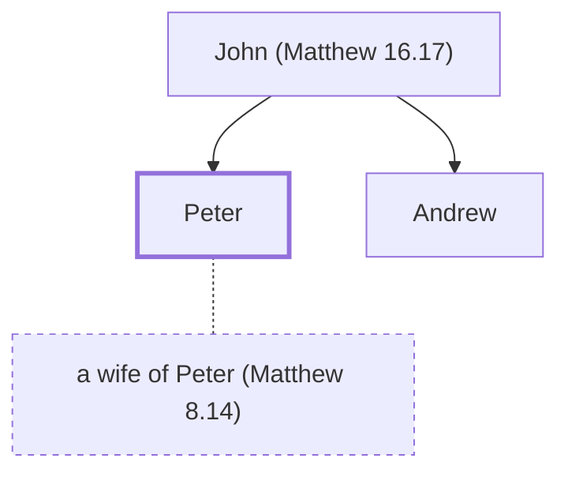

# Peter

Apostle of Jesus, leader in the early church

**Also called:** Simon, Simeon, Cephas, Bar-Jonah

**Original-language names:** Πέτρος (G4074) · Σίμων (G4613) · Συμεών (G4826) · Κηφᾶς (G2786) · Βαριωνᾶς (G0920)

## When

- **Placed around:** [[connections/timeline/1st century AD|AD 33]] *(Ussher: the median date of the passages naming them)*

## Family

- **Father:** [[connections/people/John (Matthew 16.17)|John (Matthew 16.17)]]
- **Brothers and sisters:** [[connections/people/Andrew|Andrew]]
- **Spouses:** [[connections/people/a wife of Peter (Matthew 8.14)|a wife of Peter (Matthew 8.14)]]

**Family group:** [[connections/genealogy/Family of John (Matthew 16.17)|Family of John (Matthew 16.17)]], generation 2

## Events

- [[connections/timeline/1st century AD|AD 27]] · [[connections/events/Fishers of Men|Fishers of Men]]
- [[connections/timeline/1st century AD|AD 27]] · [[connections/events/First Disciples Gathered|First Disciples Gathered]]
- [[connections/timeline/1st century AD|AD 28]] · [[connections/events/Apostles Chosen|Apostles Chosen]]
- [[connections/timeline/1st century AD|AD 28]] · [[connections/events/Jesus' 1st Tour of Galilee|Jesus' 1st Tour of Galilee]]
- [[connections/timeline/1st century AD|AD 29]] · [[connections/events/Jesus Walks on Water|Jesus Walks on Water]]
- [[connections/timeline/1st century AD|AD 29]] · [[connections/events/Commandments and Tradition Discourse|Commandments and Tradition Discourse]]
- [[connections/timeline/1st century AD|AD 29]] · [[connections/events/Peter's Confession -Upon this Rock-|Peter's Confession "Upon this Rock"]]
- [[connections/timeline/1st century AD|AD 29]] · [[connections/events/Foretelling the Death and Resurrection|Foretelling the Death and Resurrection]]
- [[connections/timeline/1st century AD|AD 29]] · [[connections/events/The Transfiguation|The Transfiguation]]
- [[connections/timeline/1st century AD|AD 29]] · [[connections/events/Tax Coin in a Fish's Mouth|Tax Coin in a Fish's Mouth]]
- [[connections/timeline/1st century AD|AD 29]] · [[connections/events/Woes and Parables with Pharisees|Woes and Parables with Pharisees]]
- [[connections/timeline/1st century AD|AD 29]] · [[connections/events/Bread of Life Sermon|Bread of Life Sermon]]
- [[connections/timeline/1st century AD|AD 30]] · [[connections/events/Olivet Discourse|Olivet Discourse]]
- [[connections/timeline/1st century AD|AD 30]] · [[connections/events/Prayer and Betrayal in Gethsemane|Prayer and Betrayal in Gethsemane]]
- [[connections/timeline/1st century AD|AD 30]] · [[connections/events/Jewish Trials|Jewish Trials]]
- [[connections/timeline/1st century AD|AD 30]] · [[connections/events/Roman Trials|Roman Trials]]
- [[connections/timeline/1st century AD|AD 30]] · [[connections/events/Teaching by the Fig Tree|Teaching by the Fig Tree]]
- [[connections/timeline/1st century AD|AD 30]] · [[connections/events/Matthias replaces Judas|Matthias replaces Judas]]
- [[connections/timeline/1st century AD|AD 30]] · [[connections/events/Peter preaches at Pentecost|Peter preaches at Pentecost]]
- [[connections/timeline/1st century AD|AD 30]] · [[connections/events/Lame man healed|Lame man healed]]
- [[connections/timeline/1st century AD|AD 30]] · [[connections/events/Peter preaches in Solomon's Portico|Peter preaches in Solomon's Portico]]
- [[connections/timeline/1st century AD|AD 30]] · [[connections/events/Peter and John's Trial|Peter and John's Trial]]
- [[connections/timeline/1st century AD|AD 30]] · [[connections/events/Ananias and Sapphira lie to God|Ananias and Sapphira lie to God]]
- [[connections/timeline/1st century AD|AD 30]] · [[connections/events/Apostles work signs and wonders in Solomon's Portico|Apostles work signs and wonders in Solomon's Portico]]
- [[connections/timeline/1st century AD|AD 30]] · [[connections/events/Apostles arrested, put on trial|Apostles arrested, put on trial]]
- [[connections/timeline/1st century AD|AD 31]] · [[connections/events/Philip preaches in Samaria|Philip preaches in Samaria]]
- [[connections/timeline/1st century AD|AD 38]] · [[connections/events/Peter heals Aeneas and Dorcas|Peter heals Aeneas and Dorcas]]
- [[connections/timeline/1st century AD|AD 38]] · [[connections/events/Peter meets Cornelius|Peter meets Cornelius]]
- [[connections/timeline/1st century AD|AD 38]] · [[connections/events/Peter preaches to gentiles in Caesarea|Peter preaches to gentiles in Caesarea]]
- [[connections/timeline/1st century AD|AD 38]] · [[connections/events/Peter defends Gentile salvation|Peter defends Gentile salvation]]
- [[connections/timeline/1st century AD|AD 40]] · [[connections/events/Herod imprisons Peter|Herod imprisons Peter]]
- [[connections/timeline/1st century AD|AD 40]] · [[connections/events/An angel rescues Peter from prison|An angel rescues Peter from prison]]
- [[connections/timeline/1st century AD|AD 46]] · [[connections/events/Jerusalem Council|Jerusalem Council]]
- [[connections/timeline/1st century AD|AD 46]] · [[connections/events/Second Missionary Journey|Second Missionary Journey]]

## Appears in

[[connections/chapters/40-matthew/Matthew 4|Matthew 4]] · [[connections/chapters/40-matthew/Matthew 8|Matthew 8]] · [[connections/chapters/40-matthew/Matthew 10|Matthew 10]] · [[connections/chapters/40-matthew/Matthew 14|Matthew 14 (2)]] · [[connections/chapters/40-matthew/Matthew 15|Matthew 15]] · [[connections/chapters/40-matthew/Matthew 16|Matthew 16 (5)]] · [[connections/chapters/40-matthew/Matthew 17|Matthew 17 (5)]] · [[connections/chapters/40-matthew/Matthew 18|Matthew 18]] · [[connections/chapters/40-matthew/Matthew 19|Matthew 19]] · [[connections/chapters/40-matthew/Matthew 26|Matthew 26 (8)]] · [[connections/chapters/41-mark/Mark 1|Mark 1 (4)]] · [[connections/chapters/41-mark/Mark 3|Mark 3]] · [[connections/chapters/41-mark/Mark 5|Mark 5]] · [[connections/chapters/41-mark/Mark 8|Mark 8 (3)]] · [[connections/chapters/41-mark/Mark 9|Mark 9 (2)]] · [[connections/chapters/41-mark/Mark 10|Mark 10]] · [[connections/chapters/41-mark/Mark 11|Mark 11]] · [[connections/chapters/41-mark/Mark 13|Mark 13]] · [[connections/chapters/41-mark/Mark 14|Mark 14 (8)]] · [[connections/chapters/41-mark/Mark 16|Mark 16 (2)]] · [[connections/chapters/42-luke/Luke 4|Luke 4]] · [[connections/chapters/42-luke/Luke 5|Luke 5 (5)]] · [[connections/chapters/42-luke/Luke 6|Luke 6]] · [[connections/chapters/42-luke/Luke 8|Luke 8 (2)]] · [[connections/chapters/42-luke/Luke 9|Luke 9 (4)]] · [[connections/chapters/42-luke/Luke 12|Luke 12]] · [[connections/chapters/42-luke/Luke 18|Luke 18]] · [[connections/chapters/42-luke/Luke 22|Luke 22 (9)]] · [[connections/chapters/42-luke/Luke 24|Luke 24 (2)]] · [[connections/chapters/43-john/John 1|John 1 (4)]] · [[connections/chapters/43-john/John 6|John 6 (2)]] · [[connections/chapters/43-john/John 13|John 13 (6)]] · [[connections/chapters/43-john/John 18|John 18 (9)]] · [[connections/chapters/43-john/John 20|John 20 (4)]] · [[connections/chapters/43-john/John 21|John 21 (9)]] · [[connections/chapters/44-acts/Acts 1|Acts 1 (2)]] · [[connections/chapters/44-acts/Acts 2|Acts 2 (3)]] · [[connections/chapters/44-acts/Acts 3|Acts 3 (6)]] · [[connections/chapters/44-acts/Acts 4|Acts 4 (3)]] · [[connections/chapters/44-acts/Acts 5|Acts 5 (5)]] · [[connections/chapters/44-acts/Acts 8|Acts 8 (2)]] · [[connections/chapters/44-acts/Acts 9|Acts 9 (5)]] · [[connections/chapters/44-acts/Acts 10|Acts 10 (16)]] · [[connections/chapters/44-acts/Acts 11|Acts 11 (4)]] · [[connections/chapters/44-acts/Acts 12|Acts 12 (9)]] · [[connections/chapters/44-acts/Acts 15|Acts 15 (2)]] · [[connections/chapters/46-1-corinthians/1 Corinthians 1|1 Corinthians 1]] · [[connections/chapters/46-1-corinthians/1 Corinthians 3|1 Corinthians 3]] · [[connections/chapters/46-1-corinthians/1 Corinthians 9|1 Corinthians 9]] · [[connections/chapters/46-1-corinthians/1 Corinthians 15|1 Corinthians 15]] · [[connections/chapters/48-galatians/Galatians 1|Galatians 1]] · [[connections/chapters/48-galatians/Galatians 2|Galatians 2 (5)]] · [[connections/chapters/60-1-peter/1 Peter 1|1 Peter 1]] · [[connections/chapters/61-2-peter/2 Peter 1|2 Peter 1]]

## Appears in the same verse as

[[connections/people/Jesus|Jesus (41)]] · [[connections/people/John (Matthew 4.21)|John (Matthew 4.21) (21)]] · [[connections/people/James (Matthew 4.21)|James (Matthew 4.21) (12)]] · [[connections/people/Andrew|Andrew (10)]] · [[connections/people/John (Matthew 16.17)|John (Matthew 16.17) (5)]] · [[connections/places/Joppa|Joppa (5)]] · [[connections/people/Zebedee|Zebedee (4)]] · [[connections/places/Jerusalem|Jerusalem (4)]] · [[connections/people/Cornelius|Cornelius (3)]] · [[connections/people/Elijah (1 Kings 17.1)|Elijah (1 Kings 17.1) (3)]] · [[connections/people/Moses|Moses (3)]] · [[connections/people/Philip (Matthew 10.3)|Philip (Matthew 10.3) (3)]] · [[connections/places/Nazareth|Nazareth (3)]] · [[connections/people/Apollos|Apollos (2)]] · [[connections/people/Bartholomew|Bartholomew (2)]] · [[connections/people/Herod (Acts 12.1)|Herod (Acts 12.1) (2)]] · [[connections/people/Paul|Paul (2)]] · [[connections/people/Simon (Acts 9.43)|Simon (Acts 9.43) (2)]] · [[connections/people/Tabitha|Tabitha (2)]] · [[connections/people/Thomas|Thomas (2)]] · [[connections/places/Chinnereth|Chinnereth (2)]] · [[connections/places/Galilee|Galilee (2)]] · [[connections/places/Lod|Lod (2)]] · [[connections/people/Aeneas|Aeneas]] · [[connections/people/Alphaeus|Alphaeus]] · [[connections/people/Ananias (Acts 5.1)|Ananias (Acts 5.1)]] · [[connections/people/Barnabas|Barnabas]] · [[connections/people/Israel|Israel]] · [[connections/people/James (Luke 6.16)|James (Luke 6.16)]] · [[connections/people/James (Matthew 10.3)|James (Matthew 10.3)]] · [[connections/people/James (Matthew 13.55)|James (Matthew 13.55)]] · [[connections/people/John (Matthew 3.1)|John (Matthew 3.1)]] · [[connections/people/Judah (Genesis 29.35)|Judah (Genesis 29.35)]] · [[connections/people/Judas (Matthew 10.3)|Judas (Matthew 10.3)]] · [[connections/people/Malchus|Malchus]] · [[connections/people/Matthew|Matthew]] · [[connections/people/Nathanael|Nathanael]] · [[connections/people/Rhoda|Rhoda]] · [[connections/people/Simon (Matthew 10.4)|Simon (Matthew 10.4)]] · [[connections/places/Antioch (Acts 11.19)|Antioch (Acts 11.19)]] · [[connections/places/Asia|Asia]] · [[connections/places/Bethsaida|Bethsaida]] · [[connections/places/Bithynia|Bithynia]] · [[connections/places/Capernaum|Capernaum]] · [[connections/places/Cappadocia|Cappadocia]] · [[connections/places/Galatia|Galatia]] · [[connections/places/Kanah (Joshua 19.28)|Kanah (Joshua 19.28)]] · [[connections/places/Olives Mount|Olives Mount]] · [[connections/places/Pontus|Pontus]] · [[connections/places/Samaria|Samaria]] · [[connections/places/Solomon's Portico|Solomon's Portico]]
