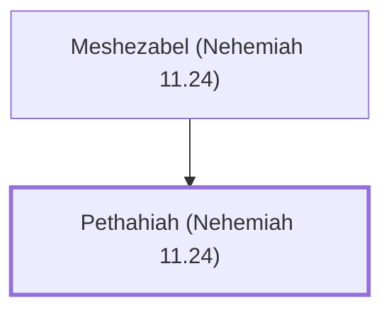

# Pethahiah (Nehemiah 11.24)

Levite appointed for the king's matters

**Original-language names:** פְּתַחְיָה (H6611)

## When

- **Placed around:** [[connections/timeline/5th century BC|445 BC]] *(Ussher: the median date of the passages naming them)*

## Family

- **Father:** [[connections/people/Meshezabel (Nehemiah 11.24)|Meshezabel (Nehemiah 11.24)]]

**Family group:** [[connections/genealogy/Family of Meshezabel (Nehemiah 11.24)|Family of Meshezabel (Nehemiah 11.24)]], generation 2

## Appears in

[[connections/chapters/16-nehemiah/Nehemiah 11|Nehemiah 11]]

## Appears in the same verse as

[[connections/people/Judah (Genesis 29.35)|Judah (Genesis 29.35)]] · [[connections/people/Meshezabel (Nehemiah 11.24)|Meshezabel (Nehemiah 11.24)]] · [[connections/people/Zerah (Genesis 38.30)|Zerah (Genesis 38.30)]]
