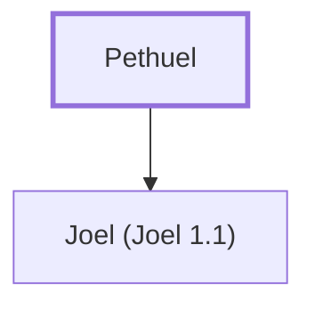

# Pethuel

Father of the prophet Joel

**Original-language names:** פְּתוּאֵל (H6602)

## When

- **Placed around:** [[connections/timeline/8th century BC|800 BC]] *(Ussher: the median date of the passages naming them)*

## Family

- **Children:** [[connections/people/Joel (Joel 1.1)|Joel (Joel 1.1)]]

**Family group:** [[connections/genealogy/Family of Pethuel|Family of Pethuel]], generation 1

## Appears in

[[connections/chapters/29-joel/Joel 1|Joel 1]]

## Appears in the same verse as

[[connections/people/Joel (Joel 1.1)|Joel (Joel 1.1)]]
