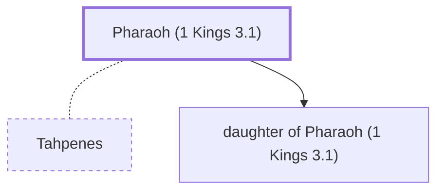

# Pharaoh (1 Kings 3.1)

Egyptian Pharaoh during Solomon's reign

**Original-language names:** פַּרְעֹה (H6547)

## When

- **Placed around:** [[connections/timeline/10th century BC|984 BC]] *(Ussher: the median date of the passages naming them)*

## Family

- **Spouses:** [[connections/people/Tahpenes|Tahpenes]]
- **Children:** [[connections/people/daughter of Pharaoh (1 Kings 3.1)|daughter of Pharaoh (1 Kings 3.1)]]
- **Tribe or nation:** Egypt

**Family group:** [[connections/genealogy/Family of father of Tahpenes (1 Kings 11.19)|Family of father of Tahpenes (1 Kings 11.19)]], generation 2

## Appears in

[[connections/chapters/11-1-kings/1 Kings 3|1 Kings 3]] · [[connections/chapters/11-1-kings/1 Kings 7|1 Kings 7]] · [[connections/chapters/11-1-kings/1 Kings 9|1 Kings 9 (2)]] · [[connections/chapters/11-1-kings/1 Kings 11|1 Kings 11 (6)]] · [[connections/chapters/14-2-chronicles/2 Chronicles 8|2 Chronicles 8]] · [[connections/chapters/22-song-of-songs/Song of Songs 1|Song of Songs 1]]

## Appears in the same verse as

[[connections/people/Solomon|Solomon (5)]] · [[connections/people/David|David (4)]] · [[connections/places/Egypt|Egypt (4)]] · [[connections/people/Hadad (1 Kings 11.14)|Hadad (1 Kings 11.14) (2)]] · [[connections/people/Tahpenes|Tahpenes (2)]] · [[connections/people/Genubath|Genubath]] · [[connections/people/Israel|Israel]] · [[connections/people/Joab (1 Samuel 26.6)|Joab (1 Samuel 26.6)]] · [[connections/places/Gezer|Gezer]] · [[connections/places/Jerusalem|Jerusalem]] · [[connections/places/Midian|Midian]] · [[connections/places/Millo|Millo]] · [[connections/places/Moab|Moab]] · [[connections/places/Paran|Paran]]
