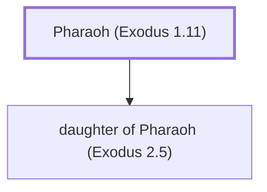

# Pharaoh (Exodus 1.11)

Egyptian Pharaoh during Moses' birth and early life

**Original-language names:** פַּרְעֹה (H6547) · Φαραώ (G5328)

## When

- **Placed around:** [[connections/timeline/16th century BC|1571 BC]] *(Ussher: the median date of the passages naming them)*

## Family

- **Children:** [[connections/people/daughter of Pharaoh (Exodus 2.5)|daughter of Pharaoh (Exodus 2.5)]]
- **Tribe or nation:** Egypt

**Family group:** [[connections/genealogy/Family of Pharaoh (Exodus 1.11)|Family of Pharaoh (Exodus 1.11)]], generation 1

## Appears in

[[connections/chapters/02-exodus/Exodus 1|Exodus 1 (3)]] · [[connections/chapters/02-exodus/Exodus 2|Exodus 2 (6)]] · [[connections/chapters/44-acts/Acts 7|Acts 7]] · [[connections/chapters/58-hebrews/Hebrews 11|Hebrews 11]]

## Appears in the same verse as

[[connections/people/Moses|Moses (3)]] · [[connections/places/Nile|Nile (2)]] · [[connections/places/Midian|Midian]] · [[connections/places/Pithom|Pithom]] · [[connections/places/Raamses|Raamses]]
