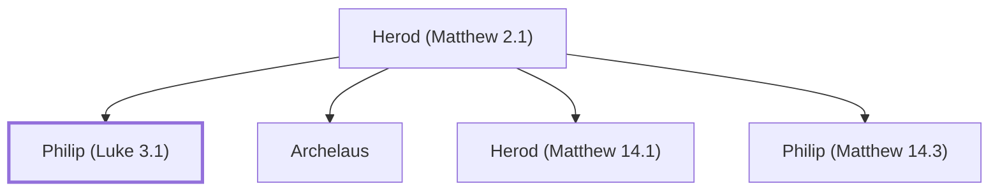

# Philip (Luke 3.1)

Tetrarch of Iturea and Traconitis

**Original-language names:** Φίλιππος (G5376)

## When

- **Placed around:** [[connections/timeline/1st century AD|AD 26]] *(Ussher: the median date of the passages naming them)*

## Family

- **Father:** [[connections/people/Herod (Matthew 2.1)|Herod (Matthew 2.1)]]
- **Brothers and sisters:** [[connections/people/Archelaus|Archelaus]], [[connections/people/Herod (Matthew 14.1)|Herod (Matthew 14.1)]], [[connections/people/Philip (Matthew 14.3)|Philip (Matthew 14.3)]]

**Family group:** [[connections/genealogy/Family of Herod (Matthew 2.1)|Family of Herod (Matthew 2.1)]], generation 2

## Appears in

[[connections/chapters/42-luke/Luke 3|Luke 3]]

## Appears in the same verse as

[[connections/people/Augustus|Augustus]] · [[connections/people/Herod (Matthew 14.1)|Herod (Matthew 14.1)]] · [[connections/people/Lysanias|Lysanias]] · [[connections/people/Pilate|Pilate]] · [[connections/people/Tiberius|Tiberius]] · [[connections/places/Abilene|Abilene]] · [[connections/places/Galilee|Galilee]] · [[connections/places/Jetur|Jetur]] · [[connections/places/Judea|Judea]] · [[connections/places/Trachonitis|Trachonitis]]
