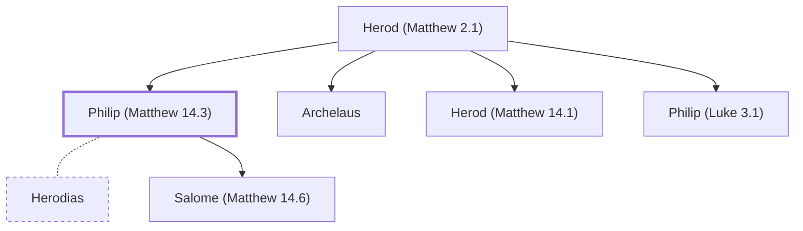

# Philip (Matthew 14.3)

Herod Antipas' brother, first husband of Herodias

**Original-language names:** Φίλιππος (G5376)

## When

- **Placed around:** [[connections/timeline/1st century AD|AD 28]] *(Ussher: the median date of the passages naming them)*

## Family

- **Father:** [[connections/people/Herod (Matthew 2.1)|Herod (Matthew 2.1)]]
- **Brothers and sisters:** [[connections/people/Archelaus|Archelaus]], [[connections/people/Herod (Matthew 14.1)|Herod (Matthew 14.1)]], [[connections/people/Philip (Luke 3.1)|Philip (Luke 3.1)]]
- **Spouses:** [[connections/people/Herodias|Herodias]]
- **Children:** [[connections/people/Salome (Matthew 14.6)|Salome (Matthew 14.6)]]

**Family group:** [[connections/genealogy/Family of Herod (Matthew 2.1)|Family of Herod (Matthew 2.1)]], generation 2

## Appears in

[[connections/chapters/40-matthew/Matthew 14|Matthew 14]] · [[connections/chapters/41-mark/Mark 6|Mark 6]] · [[connections/chapters/42-luke/Luke 3|Luke 3]]

## Appears in the same verse as

[[connections/people/Herod (Matthew 14.1)|Herod (Matthew 14.1) (3)]] · [[connections/people/Herodias|Herodias (3)]] · [[connections/people/John (Matthew 3.1)|John (Matthew 3.1) (2)]]
