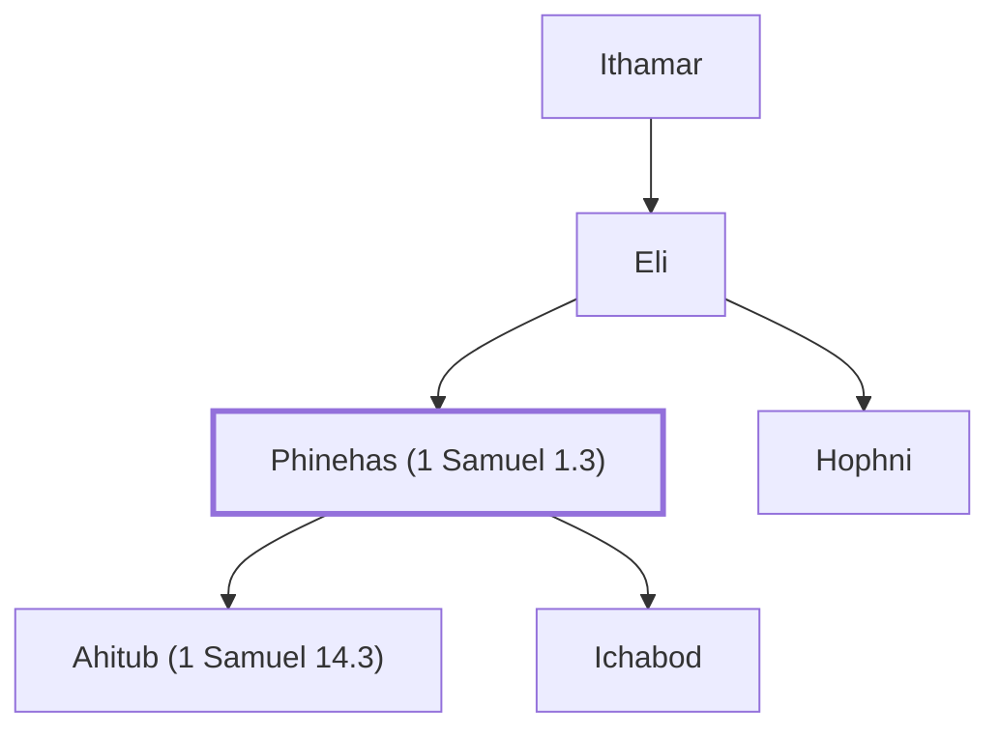

# Phinehas (1 Samuel 1.3)

Wicked son of Eli the priest

**Original-language names:** פִּינְחָס (H6372)

## When

- **Placed around:** [[connections/timeline/12th century BC|1141 BC]] *(Ussher: the median date of the passages naming them)*

## Family

- **Father:** [[connections/people/Eli|Eli]]
- **Brothers and sisters:** [[connections/people/Hophni|Hophni]]
- **Children:** [[connections/people/Ahitub (1 Samuel 14.3)|Ahitub (1 Samuel 14.3)]], [[connections/people/Ichabod|Ichabod]]
- **Tribe or nation:** Tribe of Levi

**Family group:** [[connections/genealogy/Family of Adam|Family of Adam]], generation 34

## Appears in

[[connections/chapters/09-1-samuel/1 Samuel 1|1 Samuel 1]] · [[connections/chapters/09-1-samuel/1 Samuel 2|1 Samuel 2]] · [[connections/chapters/09-1-samuel/1 Samuel 4|1 Samuel 4 (4)]] · [[connections/chapters/09-1-samuel/1 Samuel 14|1 Samuel 14]]

## Appears in the same verse as

[[connections/people/Hophni|Hophni (5)]] · [[connections/people/Eli|Eli (4)]] · [[connections/places/Shiloh|Shiloh (3)]] · [[connections/people/Ahimelech (1 Samuel 14.3)|Ahimelech (1 Samuel 14.3)]] · [[connections/people/Ahitub (1 Samuel 14.3)|Ahitub (1 Samuel 14.3)]] · [[connections/people/Ichabod|Ichabod]] · [[connections/people/Israel|Israel]] · [[connections/people/Jonathan (1 Samuel 13.2)|Jonathan (1 Samuel 13.2)]]
