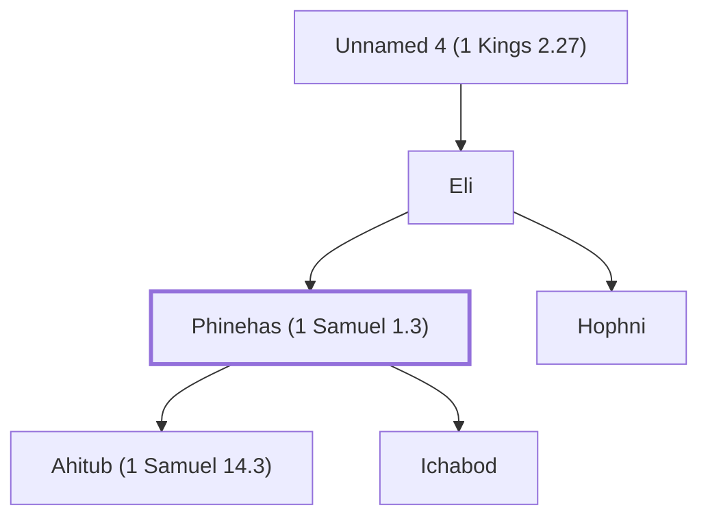

# Phinehas (1 Samuel 1.3)

Wicked son of Eli the priest

**Original-language names:** פִּינְחָס (H6372)

## When

- **Placed around:** [[connections/timeline/12th century BC|1141 BC]] *(Ussher: the median date of the passages naming them)*

## Family

- **Father:** [[connections/people/Eli|Eli]]
- **Brothers and sisters:** [[connections/people/Hophni|Hophni]]
- **Children:** [[connections/people/Ahitub (1 Samuel 14.3)|Ahitub (1 Samuel 14.3)]], [[connections/people/Ichabod|Ichabod]]
- **Tribe or nation:** Tribe of Levi

**Line of descent** (34 generations, father to son): [[connections/people/Adam|Adam]] → [[connections/people/Seth|Seth]] → [[connections/people/Enosh|Enosh]] → [[connections/people/Kenan|Kenan]] → [[connections/people/Mahalalel (Genesis 5.12)|Mahalalel (Genesis 5.12)]] → [[connections/people/Jared|Jared]] → [[connections/people/Enoch (Genesis 5.18)|Enoch (Genesis 5.18)]] → [[connections/people/Methuselah|Methuselah]] → [[connections/people/Lamech (Genesis 5.25)|Lamech (Genesis 5.25)]] → [[connections/people/Noah (Genesis 5.29)|Noah (Genesis 5.29)]] → [[connections/people/Shem|Shem]] → [[connections/people/Arpachshad|Arpachshad]] → [[connections/people/Cainan|Cainan]] → [[connections/people/Shelah (Genesis 10.24)|Shelah (Genesis 10.24)]] → [[connections/people/Eber (Genesis 10.21)|Eber (Genesis 10.21)]] → [[connections/people/Peleg|Peleg]] → [[connections/people/Reu|Reu]] → [[connections/people/Serug|Serug]] → [[connections/people/Nahor (Genesis 11.22)|Nahor (Genesis 11.22)]] → [[connections/people/Terah|Terah]] → [[connections/people/Abraham|Abraham]] → [[connections/people/Isaac|Isaac]] → [[connections/people/Israel|Israel]] → [[connections/people/Levi (Genesis 29.34)|Levi (Genesis 29.34)]] → [[connections/people/Kohath|Kohath]] → [[connections/people/Amram (Exodus 6.18)|Amram (Exodus 6.18)]] → [[connections/people/Aaron|Aaron]] → [[connections/people/Ithamar|Ithamar]] → [[connections/people/Unnamed 1 (1 Kings 2.27)|Unnamed 1 (1 Kings 2.27)]] → [[connections/people/Unnamed 2 (1 Kings 2.27)|Unnamed 2 (1 Kings 2.27)]] → [[connections/people/Unnamed 3 (1 Kings 2.27)|Unnamed 3 (1 Kings 2.27)]] → [[connections/people/Unnamed 4 (1 Kings 2.27)|Unnamed 4 (1 Kings 2.27)]] → [[connections/people/Eli|Eli]] → **Phinehas (1 Samuel 1.3)**

**Family group:** [[connections/genealogy/Family of Adam|Family of Adam]], generation 34

## Appears in

[[connections/chapters/09-1-samuel/1 Samuel 1|1 Samuel 1]] · [[connections/chapters/09-1-samuel/1 Samuel 2|1 Samuel 2]] · [[connections/chapters/09-1-samuel/1 Samuel 4|1 Samuel 4 (4)]] · [[connections/chapters/09-1-samuel/1 Samuel 14|1 Samuel 14]]

## Appears in the same verse as

[[connections/people/Hophni|Hophni (5)]] · [[connections/people/Eli|Eli (4)]] · [[connections/places/Shiloh|Shiloh (3)]] · [[connections/people/Ahimelech (1 Samuel 14.3)|Ahimelech (1 Samuel 14.3)]] · [[connections/people/Ahitub (1 Samuel 14.3)|Ahitub (1 Samuel 14.3)]] · [[connections/people/Ichabod|Ichabod]] · [[connections/people/Israel|Israel]] · [[connections/people/Jonathan (1 Samuel 13.2)|Jonathan (1 Samuel 13.2)]]
