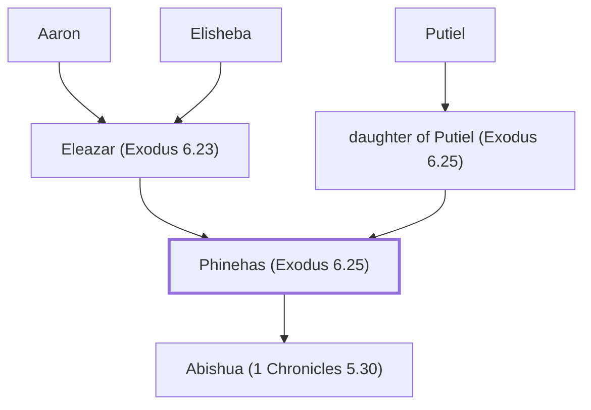

# Phinehas (Exodus 6.25)

Aaron's grandson; zealous priest who opposed idolatry

**Original-language names:** פִּינְחָס (H6372)

## When

- **Placed around:** [[connections/timeline/15th century BC|1443 BC]] *(Ussher: the median date of the passages naming them)*

## Family

- **Father:** [[connections/people/Eleazar (Exodus 6.23)|Eleazar (Exodus 6.23)]]
- **Mother:** [[connections/people/daughter of Putiel (Exodus 6.25)|daughter of Putiel (Exodus 6.25)]]
- **Children:** [[connections/people/Abishua (1 Chronicles 5.30)|Abishua (1 Chronicles 5.30)]]
- **Tribe or nation:** Tribe of Levi

**Line of descent** (29 generations, father to son): [[connections/people/Adam|Adam]] → [[connections/people/Seth|Seth]] → [[connections/people/Enosh|Enosh]] → [[connections/people/Kenan|Kenan]] → [[connections/people/Mahalalel (Genesis 5.12)|Mahalalel (Genesis 5.12)]] → [[connections/people/Jared|Jared]] → [[connections/people/Enoch (Genesis 5.18)|Enoch (Genesis 5.18)]] → [[connections/people/Methuselah|Methuselah]] → [[connections/people/Lamech (Genesis 5.25)|Lamech (Genesis 5.25)]] → [[connections/people/Noah (Genesis 5.29)|Noah (Genesis 5.29)]] → [[connections/people/Shem|Shem]] → [[connections/people/Arpachshad|Arpachshad]] → [[connections/people/Cainan|Cainan]] → [[connections/people/Shelah (Genesis 10.24)|Shelah (Genesis 10.24)]] → [[connections/people/Eber (Genesis 10.21)|Eber (Genesis 10.21)]] → [[connections/people/Peleg|Peleg]] → [[connections/people/Reu|Reu]] → [[connections/people/Serug|Serug]] → [[connections/people/Nahor (Genesis 11.22)|Nahor (Genesis 11.22)]] → [[connections/people/Terah|Terah]] → [[connections/people/Abraham|Abraham]] → [[connections/people/Isaac|Isaac]] → [[connections/people/Israel|Israel]] → [[connections/people/Levi (Genesis 29.34)|Levi (Genesis 29.34)]] → [[connections/people/Kohath|Kohath]] → [[connections/people/Amram (Exodus 6.18)|Amram (Exodus 6.18)]] → [[connections/people/Aaron|Aaron]] → [[connections/people/Eleazar (Exodus 6.23)|Eleazar (Exodus 6.23)]] → **Phinehas (Exodus 6.25)**

**Family group:** [[connections/genealogy/Family of Adam|Family of Adam]], generation 29

## Appears in

[[connections/chapters/02-exodus/Exodus 6|Exodus 6]] · [[connections/chapters/04-numbers/Numbers 25|Numbers 25 (2)]] · [[connections/chapters/04-numbers/Numbers 31|Numbers 31]] · [[connections/chapters/06-joshua/Joshua 22|Joshua 22 (4)]] · [[connections/chapters/06-joshua/Joshua 24|Joshua 24]] · [[connections/chapters/07-judges/Judges 20|Judges 20]] · [[connections/chapters/13-1-chronicles/1 Chronicles 5|1 Chronicles 5]] · [[connections/chapters/13-1-chronicles/1 Chronicles 6|1 Chronicles 6]] · [[connections/chapters/13-1-chronicles/1 Chronicles 9|1 Chronicles 9]] · [[connections/chapters/15-ezra/Ezra 7|Ezra 7]] · [[connections/chapters/15-ezra/Ezra 8|Ezra 8]] · [[connections/chapters/19-psalms/Psalms 106|Psalms 106]]

## Appears in the same verse as

[[connections/people/Eleazar (Exodus 6.23)|Eleazar (Exodus 6.23) (13)]] · [[connections/people/Aaron|Aaron (7)]] · [[connections/people/Israel|Israel (5)]] · [[connections/people/Gad (Genesis 30.11)|Gad (Genesis 30.11) (4)]] · [[connections/people/Reuben|Reuben (4)]] · [[connections/people/Abishua (1 Chronicles 5.30)|Abishua (1 Chronicles 5.30) (3)]] · [[connections/people/Manasseh (Genesis 41.51)|Manasseh (Genesis 41.51) (3)]] · [[connections/places/Gilead|Gilead (2)]] · [[connections/people/Benjamin (Genesis 35.18)|Benjamin (Genesis 35.18)]] · [[connections/people/Daniel (Ezra 8.2)|Daniel (Ezra 8.2)]] · [[connections/people/David|David]] · [[connections/people/Ephraim|Ephraim]] · [[connections/people/Gershom (Ezra 8.2)|Gershom (Ezra 8.2)]] · [[connections/people/Hattush (Ezra 8.2)|Hattush (Ezra 8.2)]] · [[connections/people/Ithamar|Ithamar]] · [[connections/people/Moses|Moses]] · [[connections/people/Putiel|Putiel]] · [[connections/places/Canaan|Canaan]] · [[connections/places/Gibeah (Joshua 18.28)|Gibeah (Joshua 18.28)]]
