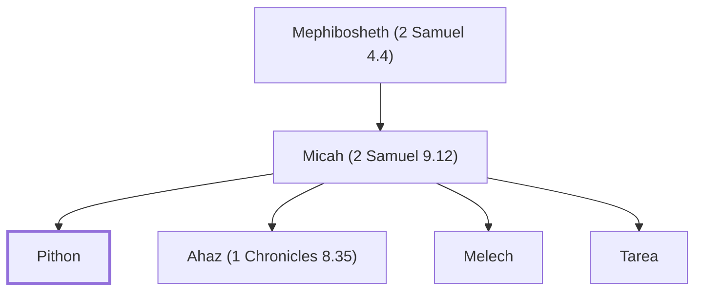

# Pithon

Descendant of King Saul

**Original-language names:** פִּיתוֹן (H6377)

## When

- **Placed around:** [[connections/timeline/12th century BC|1200 BC]] *(Ussher: the median date of the passages naming them)*

## Family

- **Father:** [[connections/people/Micah (2 Samuel 9.12)|Micah (2 Samuel 9.12)]]
- **Brothers and sisters:** [[connections/people/Ahaz (1 Chronicles 8.35)|Ahaz (1 Chronicles 8.35)]], [[connections/people/Melech|Melech]], [[connections/people/Tarea|Tarea]]
- **Tribe or nation:** Tribe of Benjamin

**Line of descent** (10 generations, father to son): [[connections/people/Aphiah|Aphiah]] → [[connections/people/Becorath|Becorath]] → [[connections/people/Zeror|Zeror]] → [[connections/people/Abiel|Abiel]] → [[connections/people/Kish (1 Samuel 9.1)|Kish (1 Samuel 9.1)]] → [[connections/people/Saul|Saul]] → [[connections/people/Jonathan (1 Samuel 13.2)|Jonathan (1 Samuel 13.2)]] → [[connections/people/Mephibosheth (2 Samuel 4.4)|Mephibosheth (2 Samuel 4.4)]] → [[connections/people/Micah (2 Samuel 9.12)|Micah (2 Samuel 9.12)]] → **Pithon**

**Family group:** [[connections/genealogy/Family of Aphiah|Family of Aphiah]], generation 10

## Appears in

[[connections/chapters/13-1-chronicles/1 Chronicles 8|1 Chronicles 8]] · [[connections/chapters/13-1-chronicles/1 Chronicles 9|1 Chronicles 9]]

## Appears in the same verse as

[[connections/people/Melech|Melech (2)]] · [[connections/people/Micah (2 Samuel 9.12)|Micah (2 Samuel 9.12) (2)]] · [[connections/people/Tarea|Tarea (2)]] · [[connections/people/Ahaz (1 Chronicles 8.35)|Ahaz (1 Chronicles 8.35)]]
