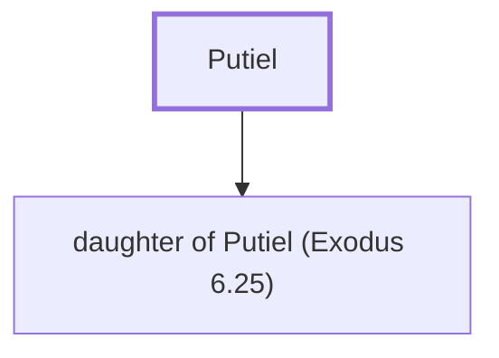

# Putiel

Father-in-law of Eleazar, son of Aaron

**Original-language names:** פּוּטִיאֵל (H6317)

## When

- **Placed around:** [[connections/timeline/15th century BC|1491 BC]] *(Ussher: the median date of the passages naming them)*

## Family

- **Children:** [[connections/people/daughter of Putiel (Exodus 6.25)|daughter of Putiel (Exodus 6.25)]]

**Family group:** [[connections/genealogy/Family of Adam|Family of Adam]], generation 1

## Appears in

[[connections/chapters/02-exodus/Exodus 6|Exodus 6]]

## Appears in the same verse as

[[connections/people/Aaron|Aaron]] · [[connections/people/Eleazar (Exodus 6.23)|Eleazar (Exodus 6.23)]] · [[connections/people/Phinehas (Exodus 6.25)|Phinehas (Exodus 6.25)]]
