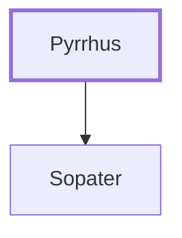

# Pyrrhus

A Berean who accompanied Paul to Asia

**Original-language names:** Πύρρος (G6077)

## When

- **Placed around:** [[connections/timeline/1st century AD|AD 60]] *(Ussher: the median date of the passages naming them)*

## Family

- **Children:** [[connections/people/Sopater|Sopater]]

**Family group:** [[connections/genealogy/Family of Pyrrhus|Family of Pyrrhus]], generation 1

## Appears in

[[connections/chapters/44-acts/Acts 20|Acts 20]]

## Appears in the same verse as

[[connections/people/Aristarchus|Aristarchus]] · [[connections/people/Gaius (Acts 20.4)|Gaius (Acts 20.4)]] · [[connections/people/Secundus|Secundus]] · [[connections/people/Sopater|Sopater]] · [[connections/people/Timothy|Timothy]] · [[connections/people/Trophimus|Trophimus]] · [[connections/people/Tychicus|Tychicus]] · [[connections/places/Asia|Asia]] · [[connections/places/Derbe|Derbe]]
