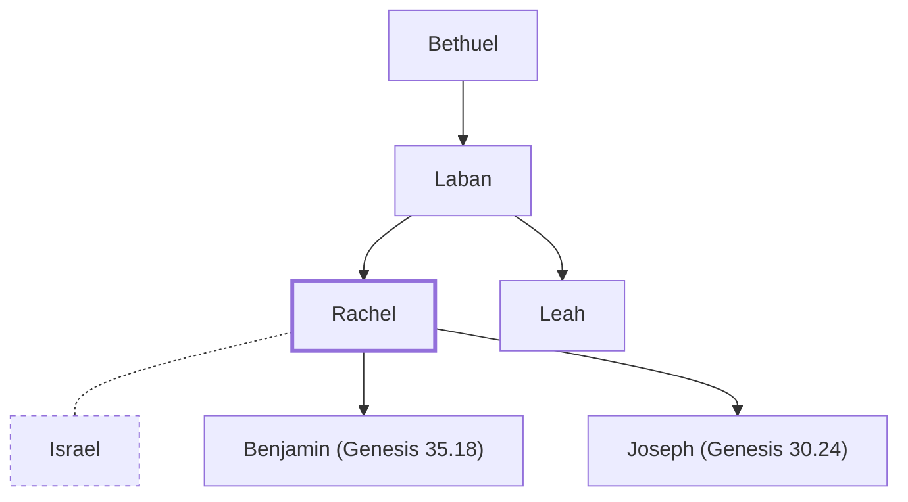

# Rachel

Wife of Jacob; mother of Joseph and Benjamin

**Original-language names:** רָחֵל (H7354) · Ῥαχήλ (G4478)

## When

- **Lived:** ? – [[connections/timeline/18th century BC|1739 BC]] *(Jones)*
- **Placed around:** [[connections/timeline/18th century BC|1739 BC]] *(Ussher: the median date of the passages naming them)*

## Family

- **Father:** [[connections/people/Laban|Laban]]
- **Brothers and sisters:** [[connections/people/Leah|Leah]]
- **Spouses:** [[connections/people/Israel|Israel]]
- **Children:** [[connections/people/Benjamin (Genesis 35.18)|Benjamin (Genesis 35.18)]], [[connections/people/Joseph (Genesis 30.24)|Joseph (Genesis 30.24)]]
- **Tribe or nation:** Early Patriarch

**Line of descent** (24 generations, father to son): [[connections/people/Adam|Adam]] → [[connections/people/Seth|Seth]] → [[connections/people/Enosh|Enosh]] → [[connections/people/Kenan|Kenan]] → [[connections/people/Mahalalel (Genesis 5.12)|Mahalalel (Genesis 5.12)]] → [[connections/people/Jared|Jared]] → [[connections/people/Enoch (Genesis 5.18)|Enoch (Genesis 5.18)]] → [[connections/people/Methuselah|Methuselah]] → [[connections/people/Lamech (Genesis 5.25)|Lamech (Genesis 5.25)]] → [[connections/people/Noah (Genesis 5.29)|Noah (Genesis 5.29)]] → [[connections/people/Shem|Shem]] → [[connections/people/Arpachshad|Arpachshad]] → [[connections/people/Cainan|Cainan]] → [[connections/people/Shelah (Genesis 10.24)|Shelah (Genesis 10.24)]] → [[connections/people/Eber (Genesis 10.21)|Eber (Genesis 10.21)]] → [[connections/people/Peleg|Peleg]] → [[connections/people/Reu|Reu]] → [[connections/people/Serug|Serug]] → [[connections/people/Nahor (Genesis 11.22)|Nahor (Genesis 11.22)]] → [[connections/people/Terah|Terah]] → [[connections/people/Nahor (Genesis 11.26)|Nahor (Genesis 11.26)]] → [[connections/people/Bethuel|Bethuel]] → [[connections/people/Laban|Laban]] → **Rachel**

**Family group:** [[connections/genealogy/Family of Adam|Family of Adam]], generation 24

## Events

- [[connections/timeline/18th century BC|1745 BC]] · [[connections/events/Birth of Joseph|Birth of Joseph]]
- [[connections/timeline/18th century BC|1739 BC]] · [[connections/events/Rachel dies giving birth to Benjamin|Rachel dies giving birth to Benjamin]]

## Appears in

[[connections/chapters/01-genesis/Genesis 29|Genesis 29 (14)]] · [[connections/chapters/01-genesis/Genesis 30|Genesis 30 (9)]] · [[connections/chapters/01-genesis/Genesis 31|Genesis 31 (6)]] · [[connections/chapters/01-genesis/Genesis 33|Genesis 33 (3)]] · [[connections/chapters/01-genesis/Genesis 35|Genesis 35 (5)]] · [[connections/chapters/01-genesis/Genesis 46|Genesis 46 (3)]] · [[connections/chapters/01-genesis/Genesis 48|Genesis 48]] · [[connections/chapters/08-ruth/Ruth 4|Ruth 4]] · [[connections/chapters/09-1-samuel/1 Samuel 10|1 Samuel 10]] · [[connections/chapters/24-jeremiah/Jeremiah 31|Jeremiah 31]] · [[connections/chapters/40-matthew/Matthew 2|Matthew 2]]

## Appears in the same verse as

[[connections/people/Israel|Israel (19)]] · [[connections/people/Leah|Leah (13)]] · [[connections/people/Laban|Laban (9)]] · [[connections/people/Joseph (Genesis 30.24)|Joseph (Genesis 30.24) (5)]] · [[connections/people/Bilhah|Bilhah (4)]] · [[connections/places/Bethlehem (Genesis 35.16)|Bethlehem (Genesis 35.16) (4)]] · [[connections/people/Benjamin (Genesis 35.18)|Benjamin (Genesis 35.18) (3)]] · [[connections/people/Dan|Dan (2)]] · [[connections/people/Naphtali|Naphtali (2)]] · [[connections/places/Ramah (Joshua 18.25)|Ramah (Joshua 18.25) (2)]] · [[connections/people/Esau|Esau]] · [[connections/people/Rebekah|Rebekah]] · [[connections/people/Reuben|Reuben]] · [[connections/places/Bethel (Genesis 12.8)|Bethel (Genesis 12.8)]] · [[connections/places/Canaan|Canaan]] · [[connections/places/Paddan|Paddan]] · [[connections/places/Zelzah|Zelzah]]
