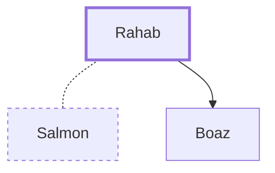

# Rahab

A Canaanite woman who helped the Israelite spies in Jericho

**Original-language names:** רָחָב (H7343) · Ῥαάβ (G4460) · Ῥαχάβ (G4477)

## When

- **Placed around:** [[connections/timeline/15th century BC|1451 BC]] *(Ussher: the median date of the passages naming them)*

## Family

- **Spouses:** [[connections/people/Salmon|Salmon]]
- **Children:** [[connections/people/Boaz|Boaz (uncertain, descendants)]]

**Family group:** [[connections/genealogy/Family of Adam|Family of Adam]], generation 32

## Appears in

[[connections/chapters/06-joshua/Joshua 2|Joshua 2 (2)]] · [[connections/chapters/06-joshua/Joshua 6|Joshua 6 (3)]] · [[connections/chapters/40-matthew/Matthew 1|Matthew 1]] · [[connections/chapters/58-hebrews/Hebrews 11|Hebrews 11]] · [[connections/chapters/59-james/James 2|James 2]]

## Appears in the same verse as

[[connections/places/Jericho|Jericho (3)]] · [[connections/people/Israel|Israel (2)]] · [[connections/people/Joshua (Exodus 17.9)|Joshua (Exodus 17.9) (2)]] · [[connections/people/Boaz|Boaz]] · [[connections/people/Jesse|Jesse]] · [[connections/people/Nun|Nun]] · [[connections/people/Obed (Ruth 4.17)|Obed (Ruth 4.17)]] · [[connections/people/Ruth|Ruth]] · [[connections/people/Salmon|Salmon]] · [[connections/places/Shittim|Shittim]]
