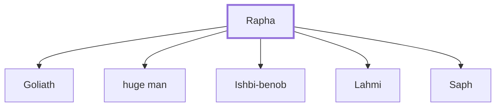

# Rapha

Ancestor of Philistine giants; his descendants fought against David's warriors.

**Original-language names:** רָפָה (H7497a)

## When

- **Placed around:** [[connections/timeline/11th century BC|1018 BC]] *(Ussher: the median date of the passages naming them)*

## Family

- **Children:** [[connections/people/Goliath|Goliath]], [[connections/people/huge man|huge man]], [[connections/people/Ishbi-benob|Ishbi-benob]], [[connections/people/Lahmi|Lahmi]], [[connections/people/Saph|Saph]]

**Family group:** [[connections/genealogy/Family of Rapha|Family of Rapha]], generation 1

## Appears in

[[connections/chapters/10-2-samuel/2 Samuel 21|2 Samuel 21 (4)]] · [[connections/chapters/13-1-chronicles/1 Chronicles 20|1 Chronicles 20 (2)]]

## Appears in the same verse as

[[connections/places/Gath|Gath (4)]] · [[connections/people/David|David (3)]] · [[connections/people/huge man|huge man (2)]] · [[connections/people/Ishbi-benob|Ishbi-benob]] · [[connections/people/Saph|Saph]] · [[connections/people/Sibbecai|Sibbecai]] · [[connections/places/Gezer|Gezer]]
