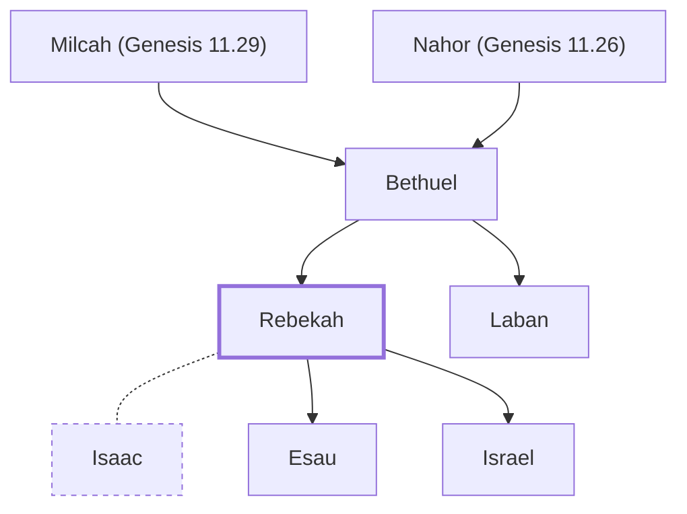

# Rebekah

Wife of Isaac; mother of Jacob and Esau

**Original-language names:** רִבְקָה (H7259) · Ῥεβέκκα (G4479)

## When

- **Lived:** [[connections/timeline/19th century BC|1875 BC]] – ? *(Jones)*
- **Placed around:** [[connections/timeline/19th century BC|1837 BC]] *(Ussher: the median date of the passages naming them)*

## Family

- **Father:** [[connections/people/Bethuel|Bethuel]]
- **Brothers and sisters:** [[connections/people/Laban|Laban]]
- **Spouses:** [[connections/people/Isaac|Isaac]]
- **Children:** [[connections/people/Esau|Esau]], [[connections/people/Israel|Israel]]
- **Tribe or nation:** Early Patriarch

**Line of descent** (23 generations, father to son): [[connections/people/Adam|Adam]] → [[connections/people/Seth|Seth]] → [[connections/people/Enosh|Enosh]] → [[connections/people/Kenan|Kenan]] → [[connections/people/Mahalalel (Genesis 5.12)|Mahalalel (Genesis 5.12)]] → [[connections/people/Jared|Jared]] → [[connections/people/Enoch (Genesis 5.18)|Enoch (Genesis 5.18)]] → [[connections/people/Methuselah|Methuselah]] → [[connections/people/Lamech (Genesis 5.25)|Lamech (Genesis 5.25)]] → [[connections/people/Noah (Genesis 5.29)|Noah (Genesis 5.29)]] → [[connections/people/Shem|Shem]] → [[connections/people/Arpachshad|Arpachshad]] → [[connections/people/Cainan|Cainan]] → [[connections/people/Shelah (Genesis 10.24)|Shelah (Genesis 10.24)]] → [[connections/people/Eber (Genesis 10.21)|Eber (Genesis 10.21)]] → [[connections/people/Peleg|Peleg]] → [[connections/people/Reu|Reu]] → [[connections/people/Serug|Serug]] → [[connections/people/Nahor (Genesis 11.22)|Nahor (Genesis 11.22)]] → [[connections/people/Terah|Terah]] → [[connections/people/Nahor (Genesis 11.26)|Nahor (Genesis 11.26)]] → [[connections/people/Bethuel|Bethuel]] → **Rebekah**

**Family group:** [[connections/genealogy/Family of Adam|Family of Adam]], generation 23

## Events

- [[connections/timeline/19th century BC|1856 BC]] · [[connections/events/Isaac Marries Rebekah|Isaac Marries Rebekah]]
- [[connections/timeline/19th century BC|1836 BC]] · [[connections/events/Birth of Jacob and Esau|Birth of Jacob and Esau]]

## Appears in

[[connections/chapters/01-genesis/Genesis 22|Genesis 22]] · [[connections/chapters/01-genesis/Genesis 24|Genesis 24 (12)]] · [[connections/chapters/01-genesis/Genesis 25|Genesis 25 (3)]] · [[connections/chapters/01-genesis/Genesis 26|Genesis 26 (3)]] · [[connections/chapters/01-genesis/Genesis 27|Genesis 27 (6)]] · [[connections/chapters/01-genesis/Genesis 28|Genesis 28]] · [[connections/chapters/01-genesis/Genesis 29|Genesis 29]] · [[connections/chapters/01-genesis/Genesis 35|Genesis 35]] · [[connections/chapters/01-genesis/Genesis 49|Genesis 49]] · [[connections/chapters/45-romans/Romans 9|Romans 9]]

## Appears in the same verse as

[[connections/people/Isaac|Isaac (12)]] · [[connections/people/Israel|Israel (8)]] · [[connections/people/Esau|Esau (7)]] · [[connections/people/Abraham|Abraham (4)]] · [[connections/people/Bethuel|Bethuel (4)]] · [[connections/people/Laban|Laban (3)]] · [[connections/people/Milcah (Genesis 11.29)|Milcah (Genesis 11.29) (2)]] · [[connections/people/Nahor (Genesis 11.26)|Nahor (Genesis 11.26) (2)]] · [[connections/people/Sarah|Sarah (2)]] · [[connections/places/Paddan|Paddan (2)]] · [[connections/people/Abimelech (Genesis 20.2)|Abimelech (Genesis 20.2)]] · [[connections/people/Deborah (Genesis 35.8)|Deborah (Genesis 35.8)]] · [[connections/people/Heth|Heth]] · [[connections/people/Leah|Leah]] · [[connections/people/Rachel|Rachel]] · [[connections/places/Allon-bacuth|Allon-bacuth]] · [[connections/places/Bethel (Genesis 12.8)|Bethel (Genesis 12.8)]]
