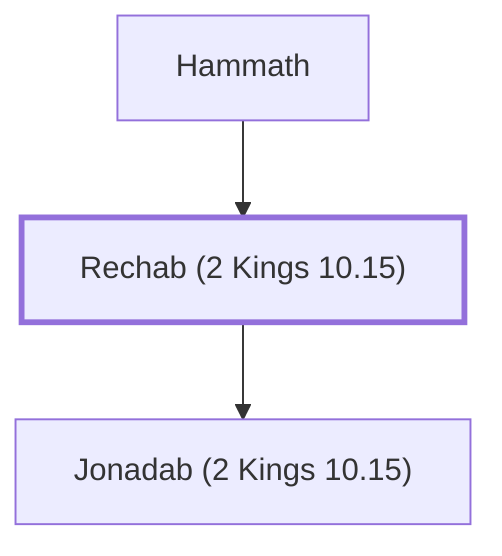

# Rechab (2 Kings 10.15)

Ancestor of the Rechabites, who were faithful to God

**Original-language names:** רֵכָב (H7394)

## When

- **Placed around:** [[connections/timeline/7th century BC|607 BC]] *(Ussher: the median date of the passages naming them)*

## Family

- **Father:** [[connections/people/Hammath|Hammath]]
- **Children:** [[connections/people/Jonadab (2 Kings 10.15)|Jonadab (2 Kings 10.15)]]
- **Tribe or nation:** Tribe of Judah

**Family group:** [[connections/genealogy/Family of Hammath|Family of Hammath]], generation 2

## Appears in

[[connections/chapters/12-2-kings/2 Kings 10|2 Kings 10 (2)]] · [[connections/chapters/13-1-chronicles/1 Chronicles 2|1 Chronicles 2]] · [[connections/chapters/24-jeremiah/Jeremiah 35|Jeremiah 35 (5)]]

## Appears in the same verse as

[[connections/people/Jonadab (2 Kings 10.15)|Jonadab (2 Kings 10.15) (7)]] · [[connections/people/Hammath|Hammath]] · [[connections/people/Israel|Israel]] · [[connections/people/Jehu (1 Kings 19.16)|Jehu (1 Kings 19.16)]] · [[connections/places/Jabez|Jabez]]
