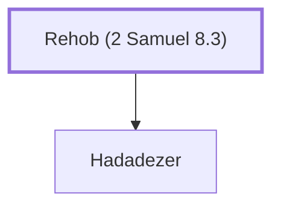

# Rehob (2 Samuel 8.3)

Father of Hadadezer, king of Zobah

**Original-language names:** רְחוֹב (H7340)

## When

- **Placed around:** [[connections/timeline/11th century BC|1040 BC]] *(Ussher: the median date of the passages naming them)*

## Family

- **Children:** [[connections/people/Hadadezer|Hadadezer]]

**Family group:** [[connections/genealogy/Family of Rehob (2 Samuel 8.3)|Family of Rehob (2 Samuel 8.3)]], generation 1

## Appears in

[[connections/chapters/10-2-samuel/2 Samuel 8|2 Samuel 8 (2)]]

## Appears in the same verse as

[[connections/people/Hadadezer|Hadadezer (2)]] · [[connections/places/Zobah|Zobah (2)]] · [[connections/people/David|David]] · [[connections/places/Amalek|Amalek]] · [[connections/places/Ammon|Ammon]] · [[connections/places/Edom|Edom]] · [[connections/places/Euphrates|Euphrates]] · [[connections/places/Moab|Moab]]
