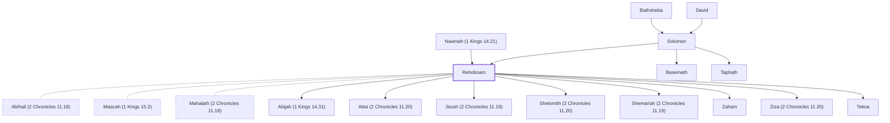

# Rehoboam

Son of Solomon, first king of Judah

**Also called:** Roboam

**Original-language names:** רְחַבְעָם (H7346) · Ῥοβοάμ (G4497)

## When

- **Lived:** [[connections/timeline/11th century BC|1016 BC]] – [[connections/timeline/10th century BC|958 BC]] *(Jones)*
- **Placed around:** [[connections/timeline/10th century BC|975 BC]] *(Ussher: the median date of the passages naming them)*

## Family

- **Father:** [[connections/people/Solomon|Solomon]]
- **Mother:** [[connections/people/Naamah (1 Kings 14.21)|Naamah (1 Kings 14.21)]]
- **Brothers and sisters:** [[connections/people/Basemath|Basemath]], [[connections/people/Taphath|Taphath]]
- **Spouses:** [[connections/people/Abihail (2 Chronicles 11.18)|Abihail (2 Chronicles 11.18)]], [[connections/people/Maacah (1 Kings 15.2)|Maacah (1 Kings 15.2)]], [[connections/people/Mahalath (2 Chronicles 11.18)|Mahalath (2 Chronicles 11.18)]]
- **Children:** [[connections/people/Abijah (1 Kings 14.31)|Abijah (1 Kings 14.31)]], [[connections/people/Attai (2 Chronicles 11.20)|Attai (2 Chronicles 11.20)]], [[connections/people/Jeush (2 Chronicles 11.19)|Jeush (2 Chronicles 11.19)]], [[connections/people/Shelomith (2 Chronicles 11.20)|Shelomith (2 Chronicles 11.20)]], [[connections/people/Shemariah (2 Chronicles 11.19)|Shemariah (2 Chronicles 11.19)]], [[connections/people/Zaham|Zaham]], [[connections/people/Ziza (2 Chronicles 11.20)|Ziza (2 Chronicles 11.20)]], [[connections/places/Tekoa|Tekoa (founder)]]
- **Tribe or nation:** Tribe of Judah

**Line of descent** (36 generations, father to son): [[connections/people/Adam|Adam]] → [[connections/people/Seth|Seth]] → [[connections/people/Enosh|Enosh]] → [[connections/people/Kenan|Kenan]] → [[connections/people/Mahalalel (Genesis 5.12)|Mahalalel (Genesis 5.12)]] → [[connections/people/Jared|Jared]] → [[connections/people/Enoch (Genesis 5.18)|Enoch (Genesis 5.18)]] → [[connections/people/Methuselah|Methuselah]] → [[connections/people/Lamech (Genesis 5.25)|Lamech (Genesis 5.25)]] → [[connections/people/Noah (Genesis 5.29)|Noah (Genesis 5.29)]] → [[connections/people/Shem|Shem]] → [[connections/people/Arpachshad|Arpachshad]] → [[connections/people/Cainan|Cainan]] → [[connections/people/Shelah (Genesis 10.24)|Shelah (Genesis 10.24)]] → [[connections/people/Eber (Genesis 10.21)|Eber (Genesis 10.21)]] → [[connections/people/Peleg|Peleg]] → [[connections/people/Reu|Reu]] → [[connections/people/Serug|Serug]] → [[connections/people/Nahor (Genesis 11.22)|Nahor (Genesis 11.22)]] → [[connections/people/Terah|Terah]] → [[connections/people/Abraham|Abraham]] → [[connections/people/Isaac|Isaac]] → [[connections/people/Israel|Israel]] → [[connections/people/Judah (Genesis 29.35)|Judah (Genesis 29.35)]] → [[connections/people/Perez|Perez]] → [[connections/people/Hezron (Genesis 46.12)|Hezron (Genesis 46.12)]] → [[connections/people/Ram (Ruth 4.19)|Ram (Ruth 4.19)]] → [[connections/people/Amminadab (Exodus 6.23)|Amminadab (Exodus 6.23)]] → [[connections/people/Nahshon|Nahshon]] → [[connections/people/Salmon|Salmon]] → [[connections/people/Boaz|Boaz]] → [[connections/people/Obed (Ruth 4.17)|Obed (Ruth 4.17)]] → [[connections/people/Jesse|Jesse]] → [[connections/people/David|David]] → [[connections/people/Solomon|Solomon]] → **Rehoboam**

**Family group:** [[connections/genealogy/Family of Adam|Family of Adam]], generation 36

## Events

- [[connections/timeline/10th century BC|975 BC]] · [[connections/events/Reign of Rehoboam|Reign of Rehoboam]]

## Appears in

[[connections/chapters/11-1-kings/1 Kings 11|1 Kings 11]] · [[connections/chapters/11-1-kings/1 Kings 12|1 Kings 12 (9)]] · [[connections/chapters/11-1-kings/1 Kings 14|1 Kings 14 (6)]] · [[connections/chapters/11-1-kings/1 Kings 15|1 Kings 15]] · [[connections/chapters/13-1-chronicles/1 Chronicles 3|1 Chronicles 3]] · [[connections/chapters/14-2-chronicles/2 Chronicles 9|2 Chronicles 9]] · [[connections/chapters/14-2-chronicles/2 Chronicles 10|2 Chronicles 10 (7)]] · [[connections/chapters/14-2-chronicles/2 Chronicles 11|2 Chronicles 11 (7)]] · [[connections/chapters/14-2-chronicles/2 Chronicles 12|2 Chronicles 12 (7)]] · [[connections/chapters/14-2-chronicles/2 Chronicles 13|2 Chronicles 13]] · [[connections/chapters/40-matthew/Matthew 1|Matthew 1]]

## Appears in the same verse as

[[connections/people/Israel|Israel (14)]] · [[connections/people/Judah (Genesis 29.35)|Judah (Genesis 29.35) (12)]] · [[connections/people/Solomon|Solomon (12)]] · [[connections/places/Jerusalem|Jerusalem (11)]] · [[connections/people/Jeroboam (1 Kings 11.26)|Jeroboam (1 Kings 11.26) (7)]] · [[connections/people/David|David (6)]] · [[connections/people/Abijah (1 Kings 14.31)|Abijah (1 Kings 14.31) (5)]] · [[connections/people/Benjamin (Genesis 35.18)|Benjamin (Genesis 35.18) (4)]] · [[connections/people/Naamah (1 Kings 14.21)|Naamah (1 Kings 14.21) (3)]] · [[connections/people/Shishak|Shishak (3)]] · [[connections/people/Adoram|Adoram (2)]] · [[connections/people/Asa (1 Kings 15.8)|Asa (1 Kings 15.8) (2)]] · [[connections/people/Maacah (1 Kings 15.2)|Maacah (1 Kings 15.2) (2)]] · [[connections/people/Shemaiah (1 Kings 12.22)|Shemaiah (1 Kings 12.22) (2)]] · [[connections/places/Egypt|Egypt (2)]] · [[connections/places/Shechem|Shechem (2)]] · [[connections/people/Abihail (2 Chronicles 11.18)|Abihail (2 Chronicles 11.18)]] · [[connections/people/Absalom|Absalom]] · [[connections/people/Eliab (1 Samuel 16.6)|Eliab (1 Samuel 16.6)]] · [[connections/people/Iddo (2 Chronicles 9.29)|Iddo (2 Chronicles 9.29)]] · [[connections/people/Jehoshaphat (1 Kings 15.24)|Jehoshaphat (1 Kings 15.24)]] · [[connections/people/Jerimoth (2 Chronicles 11.18)|Jerimoth (2 Chronicles 11.18)]] · [[connections/people/Jesse|Jesse]] · [[connections/people/Mahalath (2 Chronicles 11.18)|Mahalath (2 Chronicles 11.18)]]
