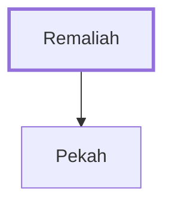

# Remaliah

Father of Pekah, king of Israel

**Original-language names:** רְמַלְיָ֜הוּ (H7425)

## When

- **Placed around:** [[connections/timeline/8th century BC|741 BC]] *(Ussher: the median date of the passages naming them)*

## Family

- **Children:** [[connections/people/Pekah|Pekah]]
- **Tribe or nation:** Israel

**Family group:** [[connections/genealogy/Family of Remaliah|Family of Remaliah]], generation 1

## Appears in

[[connections/chapters/12-2-kings/2 Kings 15|2 Kings 15 (5)]] · [[connections/chapters/12-2-kings/2 Kings 16|2 Kings 16 (2)]] · [[connections/chapters/14-2-chronicles/2 Chronicles 28|2 Chronicles 28]] · [[connections/chapters/23-isaiah/Isaiah 7|Isaiah 7 (4)]] · [[connections/chapters/23-isaiah/Isaiah 8|Isaiah 8]]

## Appears in the same verse as

[[connections/people/Pekah|Pekah (9)]] · [[connections/people/Judah (Genesis 29.35)|Judah (Genesis 29.35) (6)]] · [[connections/people/Rezin (2 Kings 15.37)|Rezin (2 Kings 15.37) (5)]] · [[connections/places/Syria|Syria (5)]] · [[connections/people/Israel|Israel (4)]] · [[connections/people/Jotham (2 Kings 15.5)|Jotham (2 Kings 15.5) (4)]] · [[connections/people/Uzziah (2 Kings 14.21)|Uzziah (2 Kings 14.21) (4)]] · [[connections/people/Ahaz (2 Kings 15.38)|Ahaz (2 Kings 15.38) (3)]] · [[connections/places/Samaria|Samaria (3)]] · [[connections/people/Ephraim|Ephraim (2)]] · [[connections/places/Jerusalem|Jerusalem (2)]] · [[connections/people/Argob|Argob]] · [[connections/people/Arieh|Arieh]] · [[connections/people/Elah (2 Kings 15.30)|Elah (2 Kings 15.30)]] · [[connections/people/Hoshea (2 Kings 15.30)|Hoshea (2 Kings 15.30)]] · [[connections/places/Shelah|Shelah]]
