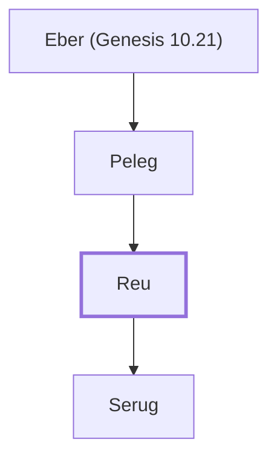

# Reu

Son of Peleg, ancestor of Abraham

**Original-language names:** רְעוּ (H7466) · Ῥαγαῦ (G4466)

## When

- **Lived:** [[connections/timeline/23rd century BC|2217 BC]] – [[connections/timeline/20th century BC|1978 BC]] *(Jones)*
- **Placed around:** [[connections/timeline/21st century BC|2008 BC]] *(Ussher: the median date of the passages naming them)*

## Family

- **Father:** [[connections/people/Peleg|Peleg]]
- **Children:** [[connections/people/Serug|Serug]]
- **Tribe or nation:** Early Patriarch

**Line of descent** (17 generations, father to son): [[connections/people/Adam|Adam]] → [[connections/people/Seth|Seth]] → [[connections/people/Enosh|Enosh]] → [[connections/people/Kenan|Kenan]] → [[connections/people/Mahalalel (Genesis 5.12)|Mahalalel (Genesis 5.12)]] → [[connections/people/Jared|Jared]] → [[connections/people/Enoch (Genesis 5.18)|Enoch (Genesis 5.18)]] → [[connections/people/Methuselah|Methuselah]] → [[connections/people/Lamech (Genesis 5.25)|Lamech (Genesis 5.25)]] → [[connections/people/Noah (Genesis 5.29)|Noah (Genesis 5.29)]] → [[connections/people/Shem|Shem]] → [[connections/people/Arpachshad|Arpachshad]] → [[connections/people/Cainan|Cainan]] → [[connections/people/Shelah (Genesis 10.24)|Shelah (Genesis 10.24)]] → [[connections/people/Eber (Genesis 10.21)|Eber (Genesis 10.21)]] → [[connections/people/Peleg|Peleg]] → **Reu**

**Family group:** [[connections/genealogy/Family of Adam|Family of Adam]], generation 17

## Events

- [[connections/timeline/23rd century BC|2217 BC]] · [[connections/events/Birth of Reu|Birth of Reu]]
- [[connections/timeline/23rd century BC|2217 BC]] · [[connections/events/Lifetime of Reu|Lifetime of Reu]]
- [[connections/timeline/22nd century BC|2185 BC]] · [[connections/events/Birth of Serug|Birth of Serug]]
- [[connections/timeline/20th century BC|1978 BC]] · [[connections/events/Death of Reu|Death of Reu]]

## Appears in

[[connections/chapters/01-genesis/Genesis 11|Genesis 11 (4)]] · [[connections/chapters/13-1-chronicles/1 Chronicles 1|1 Chronicles 1]] · [[connections/chapters/42-luke/Luke 3|Luke 3]]

## Appears in the same verse as

[[connections/people/Peleg|Peleg (4)]] · [[connections/people/Serug|Serug (3)]] · [[connections/people/Eber (Genesis 10.21)|Eber (Genesis 10.21) (2)]] · [[connections/people/Shelah (Genesis 10.24)|Shelah (Genesis 10.24)]]
