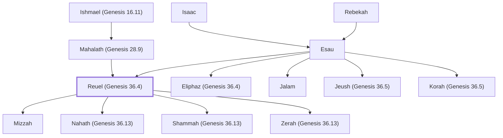

# Reuel (Genesis 36.4)

Son of Esau and Basemath, a chief of Edom

**Original-language names:** רְעוּאֵל (H7467)

## When

- **Placed around:** [[connections/timeline/18th century BC|1774 BC]] *(Ussher: the median date of the passages naming them)*

## Family

- **Father:** [[connections/people/Esau|Esau]]
- **Mother:** [[connections/people/Mahalath (Genesis 28.9)|Mahalath (Genesis 28.9)]]
- **Brothers and sisters:** [[connections/people/Eliphaz (Genesis 36.4)|Eliphaz (Genesis 36.4)]], [[connections/people/Jalam|Jalam]], [[connections/people/Jeush (Genesis 36.5)|Jeush (Genesis 36.5)]], [[connections/people/Korah (Genesis 36.5)|Korah (Genesis 36.5)]]
- **Children:** [[connections/people/Mizzah|Mizzah]], [[connections/people/Nahath (Genesis 36.13)|Nahath (Genesis 36.13)]], [[connections/people/Shammah (Genesis 36.13)|Shammah (Genesis 36.13)]], [[connections/people/Zerah (Genesis 36.13)|Zerah (Genesis 36.13)]]
- **Tribe or nation:** Edom

**Line of descent** (24 generations, father to son): [[connections/people/Adam|Adam]] → [[connections/people/Seth|Seth]] → [[connections/people/Enosh|Enosh]] → [[connections/people/Kenan|Kenan]] → [[connections/people/Mahalalel (Genesis 5.12)|Mahalalel (Genesis 5.12)]] → [[connections/people/Jared|Jared]] → [[connections/people/Enoch (Genesis 5.18)|Enoch (Genesis 5.18)]] → [[connections/people/Methuselah|Methuselah]] → [[connections/people/Lamech (Genesis 5.25)|Lamech (Genesis 5.25)]] → [[connections/people/Noah (Genesis 5.29)|Noah (Genesis 5.29)]] → [[connections/people/Shem|Shem]] → [[connections/people/Arpachshad|Arpachshad]] → [[connections/people/Cainan|Cainan]] → [[connections/people/Shelah (Genesis 10.24)|Shelah (Genesis 10.24)]] → [[connections/people/Eber (Genesis 10.21)|Eber (Genesis 10.21)]] → [[connections/people/Peleg|Peleg]] → [[connections/people/Reu|Reu]] → [[connections/people/Serug|Serug]] → [[connections/people/Nahor (Genesis 11.22)|Nahor (Genesis 11.22)]] → [[connections/people/Terah|Terah]] → [[connections/people/Abraham|Abraham]] → [[connections/people/Isaac|Isaac]] → [[connections/people/Esau|Esau]] → **Reuel (Genesis 36.4)**

**Family group:** [[connections/genealogy/Family of Adam|Family of Adam]], generation 24

## Appears in

[[connections/chapters/01-genesis/Genesis 36|Genesis 36 (4)]] · [[connections/chapters/13-1-chronicles/1 Chronicles 1|1 Chronicles 1 (2)]]

## Appears in the same verse as

[[connections/people/Esau|Esau (5)]] · [[connections/people/Mahalath (Genesis 28.9)|Mahalath (Genesis 28.9) (4)]] · [[connections/people/Eliphaz (Genesis 36.4)|Eliphaz (Genesis 36.4) (3)]] · [[connections/people/Mizzah|Mizzah (3)]] · [[connections/people/Nahath (Genesis 36.13)|Nahath (Genesis 36.13) (3)]] · [[connections/people/Shammah (Genesis 36.13)|Shammah (Genesis 36.13) (3)]] · [[connections/people/Zerah (Genesis 36.13)|Zerah (Genesis 36.13) (3)]] · [[connections/people/Adah (Genesis 26.34)|Adah (Genesis 26.34) (2)]] · [[connections/people/Jalam|Jalam]] · [[connections/people/Jeush (Genesis 36.5)|Jeush (Genesis 36.5)]] · [[connections/people/Korah (Genesis 36.5)|Korah (Genesis 36.5)]] · [[connections/places/Edom|Edom]]
