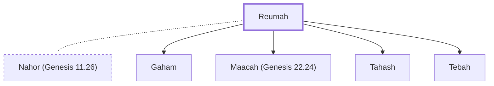

# Reumah

Concubine of Nahor, Abraham's brother

**Original-language names:** רְאוּמָה (H7208)

## When

- **Placed around:** [[connections/timeline/19th century BC|1862 BC]] *(Ussher: the median date of the passages naming them)*

## Family

- **Spouses:** [[connections/people/Nahor (Genesis 11.26)|Nahor (Genesis 11.26)]]
- **Children:** [[connections/people/Gaham|Gaham]], [[connections/people/Maacah (Genesis 22.24)|Maacah (Genesis 22.24)]], [[connections/people/Tahash|Tahash]], [[connections/people/Tebah|Tebah]]

**Family group:** [[connections/genealogy/Family of Adam|Family of Adam]], generation 21

## Appears in

[[connections/chapters/01-genesis/Genesis 22|Genesis 22]]

## Appears in the same verse as

[[connections/people/Gaham|Gaham]] · [[connections/people/Maacah (Genesis 22.24)|Maacah (Genesis 22.24)]] · [[connections/people/Tahash|Tahash]] · [[connections/people/Tebah|Tebah]]
