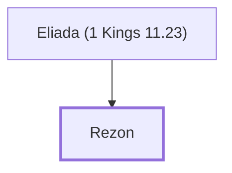

# Rezon

Son of Eliada, adversary of Solomon

**Original-language names:** רְזוֹן (H7331)

## When

- **Placed around:** [[connections/timeline/10th century BC|984 BC]] *(Ussher: the median date of the passages naming them)*

## Family

- **Father:** [[connections/people/Eliada (1 Kings 11.23)|Eliada (1 Kings 11.23)]]

**Family group:** [[connections/genealogy/Family of Eliada (1 Kings 11.23)|Family of Eliada (1 Kings 11.23)]], generation 2

## Appears in

[[connections/chapters/11-1-kings/1 Kings 11|1 Kings 11]]

## Appears in the same verse as

[[connections/people/Eliada (1 Kings 11.23)|Eliada (1 Kings 11.23)]] · [[connections/people/Hadadezer|Hadadezer]] · [[connections/places/Zobah|Zobah]]
