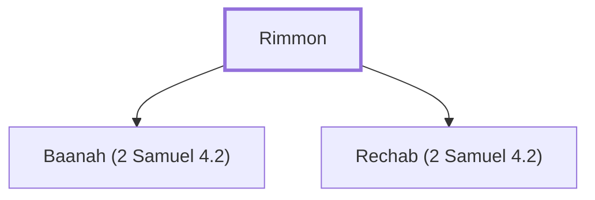

# Rimmon

Father of Baanah and Rechab, murderers of Ish-bosheth

**Original-language names:** רִמּוֹן (H7417b)

## When

- **Placed around:** [[connections/timeline/11th century BC|1048 BC]] *(Ussher: the median date of the passages naming them)*

## Family

- **Children:** [[connections/people/Baanah (2 Samuel 4.2)|Baanah (2 Samuel 4.2)]], [[connections/people/Rechab (2 Samuel 4.2)|Rechab (2 Samuel 4.2)]]
- **Tribe or nation:** Tribe of Benjamin

**Family group:** [[connections/genealogy/Family of Rimmon|Family of Rimmon]], generation 1

## Appears in

[[connections/chapters/10-2-samuel/2 Samuel 4|2 Samuel 4 (3)]]

## Appears in the same verse as

[[connections/people/Baanah (2 Samuel 4.2)|Baanah (2 Samuel 4.2) (3)]] · [[connections/people/Rechab (2 Samuel 4.2)|Rechab (2 Samuel 4.2) (3)]] · [[connections/people/Benjamin (Genesis 35.18)|Benjamin (Genesis 35.18)]] · [[connections/people/David|David]] · [[connections/people/Ish-bosheth|Ish-bosheth]] · [[connections/people/Saul|Saul]] · [[connections/places/Beeroth|Beeroth]]
