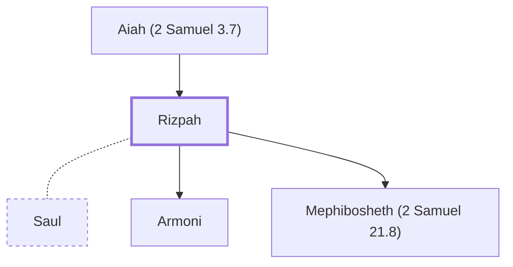

# Rizpah

Concubine of Saul; mother of Armoni and Mephibosheth

**Original-language names:** רִצְפָּה (H7532)

## When

- **Placed around:** [[connections/timeline/11th century BC|1018 BC]] *(Ussher: the median date of the passages naming them)*

## Family

- **Father:** [[connections/people/Aiah (2 Samuel 3.7)|Aiah (2 Samuel 3.7)]]
- **Spouses:** [[connections/people/Saul|Saul]]
- **Children:** [[connections/people/Armoni|Armoni]], [[connections/people/Mephibosheth (2 Samuel 21.8)|Mephibosheth (2 Samuel 21.8)]]

**Family group:** [[connections/genealogy/Family of Aphiah|Family of Aphiah]], generation 2

## Appears in

[[connections/chapters/10-2-samuel/2 Samuel 3|2 Samuel 3]] · [[connections/chapters/10-2-samuel/2 Samuel 21|2 Samuel 21 (3)]]

## Appears in the same verse as

[[connections/people/Aiah (2 Samuel 3.7)|Aiah (2 Samuel 3.7) (4)]] · [[connections/people/Saul|Saul (3)]] · [[connections/people/Abner|Abner]] · [[connections/people/Adriel|Adriel]] · [[connections/people/Armoni|Armoni]] · [[connections/people/Barzillai (2 Samuel 21.8)|Barzillai (2 Samuel 21.8)]] · [[connections/people/David|David]] · [[connections/people/Mephibosheth (2 Samuel 21.8)|Mephibosheth (2 Samuel 21.8)]] · [[connections/people/Merab|Merab]]
