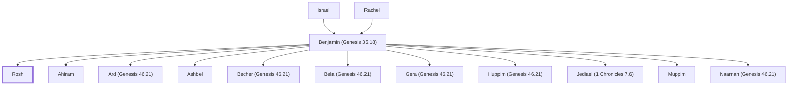

# Rosh

Son of Benjamin, grandson of Jacob

**Also called:** Rapha

**Original-language names:** רֹאשׁ (H7220) · רָפָא (H7498)

## When

- **Placed around:** [[connections/timeline/18th century BC|1706 BC]] *(Ussher: the median date of the passages naming them)*

## Family

- **Father:** [[connections/people/Benjamin (Genesis 35.18)|Benjamin (Genesis 35.18)]]
- **Brothers and sisters:** [[connections/people/Ahiram|Ahiram]], [[connections/people/Ard (Genesis 46.21)|Ard (Genesis 46.21)]], [[connections/people/Ashbel|Ashbel]], [[connections/people/Becher (Genesis 46.21)|Becher (Genesis 46.21)]], [[connections/people/Bela (Genesis 46.21)|Bela (Genesis 46.21)]], [[connections/people/Gera (Genesis 46.21)|Gera (Genesis 46.21)]], [[connections/people/Huppim (Genesis 46.21)|Huppim (Genesis 46.21)]], [[connections/people/Jediael (1 Chronicles 7.6)|Jediael (1 Chronicles 7.6)]], [[connections/people/Muppim|Muppim]], [[connections/people/Naaman (Genesis 46.21)|Naaman (Genesis 46.21)]]
- **Tribe or nation:** Tribe of Benjamin

**Line of descent** (25 generations, father to son): [[connections/people/Adam|Adam]] → [[connections/people/Seth|Seth]] → [[connections/people/Enosh|Enosh]] → [[connections/people/Kenan|Kenan]] → [[connections/people/Mahalalel (Genesis 5.12)|Mahalalel (Genesis 5.12)]] → [[connections/people/Jared|Jared]] → [[connections/people/Enoch (Genesis 5.18)|Enoch (Genesis 5.18)]] → [[connections/people/Methuselah|Methuselah]] → [[connections/people/Lamech (Genesis 5.25)|Lamech (Genesis 5.25)]] → [[connections/people/Noah (Genesis 5.29)|Noah (Genesis 5.29)]] → [[connections/people/Shem|Shem]] → [[connections/people/Arpachshad|Arpachshad]] → [[connections/people/Cainan|Cainan]] → [[connections/people/Shelah (Genesis 10.24)|Shelah (Genesis 10.24)]] → [[connections/people/Eber (Genesis 10.21)|Eber (Genesis 10.21)]] → [[connections/people/Peleg|Peleg]] → [[connections/people/Reu|Reu]] → [[connections/people/Serug|Serug]] → [[connections/people/Nahor (Genesis 11.22)|Nahor (Genesis 11.22)]] → [[connections/people/Terah|Terah]] → [[connections/people/Abraham|Abraham]] → [[connections/people/Isaac|Isaac]] → [[connections/people/Israel|Israel]] → [[connections/people/Benjamin (Genesis 35.18)|Benjamin (Genesis 35.18)]] → **Rosh**

**Family group:** [[connections/genealogy/Family of Adam|Family of Adam]], generation 25

## Appears in

[[connections/chapters/01-genesis/Genesis 46|Genesis 46]] · [[connections/chapters/13-1-chronicles/1 Chronicles 8|1 Chronicles 8]]

## Appears in the same verse as

[[connections/people/Naaman (Genesis 46.21)|Naaman (Genesis 46.21) (2)]] · [[connections/people/Ahiram|Ahiram]] · [[connections/people/Ard (Genesis 46.21)|Ard (Genesis 46.21)]] · [[connections/people/Ashbel|Ashbel]] · [[connections/people/Becher (Genesis 46.21)|Becher (Genesis 46.21)]] · [[connections/people/Bela (Genesis 46.21)|Bela (Genesis 46.21)]] · [[connections/people/Benjamin (Genesis 35.18)|Benjamin (Genesis 35.18)]] · [[connections/people/Gera (Genesis 46.21)|Gera (Genesis 46.21)]] · [[connections/people/Huppim (Genesis 46.21)|Huppim (Genesis 46.21)]] · [[connections/people/Muppim|Muppim]]
