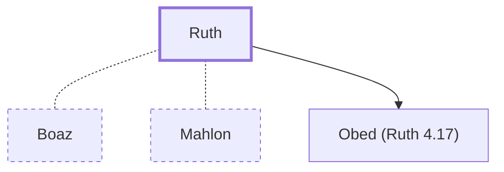

# Ruth

Moabite woman, ancestor of David and Jesus

**Original-language names:** רוּת (H7327) · Ῥούθ (G4503)

## When

- **Lived:** [[connections/timeline/12th century BC|1115 BC]] – ? *(Jones)*
- **Placed around:** [[connections/timeline/14th century BC|1307 BC]] *(Ussher: the median date of the passages naming them)*

## Family

- **Spouses:** [[connections/people/Boaz|Boaz]], [[connections/people/Mahlon|Mahlon]]
- **Children:** [[connections/people/Obed (Ruth 4.17)|Obed (Ruth 4.17)]]
- **Tribe or nation:** Moab

**Family group:** [[connections/genealogy/Family of Adam|Family of Adam]], generation 33

## Appears in

[[connections/chapters/08-ruth/Ruth 1|Ruth 1 (4)]] · [[connections/chapters/08-ruth/Ruth 2|Ruth 2 (4)]] · [[connections/chapters/08-ruth/Ruth 3|Ruth 3]] · [[connections/chapters/08-ruth/Ruth 4|Ruth 4 (3)]] · [[connections/chapters/40-matthew/Matthew 1|Matthew 1]]

## Appears in the same verse as

[[connections/places/Moab|Moab (6)]] · [[connections/people/Boaz|Boaz (4)]] · [[connections/people/Naomi|Naomi (4)]] · [[connections/people/Orpah|Orpah (2)]] · [[connections/people/Jesse|Jesse]] · [[connections/people/Mahlon|Mahlon]] · [[connections/people/Obed (Ruth 4.17)|Obed (Ruth 4.17)]] · [[connections/people/Rahab|Rahab]] · [[connections/people/Salmon|Salmon]] · [[connections/places/Bethlehem (Genesis 35.16)|Bethlehem (Genesis 35.16)]]
