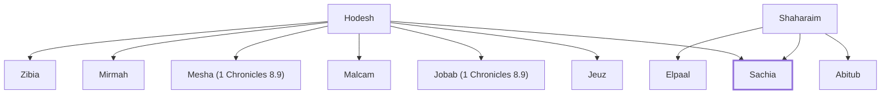

# Sachia

Son of Shaharaim, a Benjamite

**Original-language names:** שָֽׂכְיָה (H7634)

## Family

- **Father:** [[connections/people/Shaharaim|Shaharaim]]
- **Mother:** [[connections/people/Hodesh|Hodesh]]
- **Brothers and sisters:** [[connections/people/Abitub|Abitub]], [[connections/people/Elpaal|Elpaal]], [[connections/people/Jeuz|Jeuz]], [[connections/people/Jobab (1 Chronicles 8.9)|Jobab (1 Chronicles 8.9)]], [[connections/people/Malcam|Malcam]], [[connections/people/Mesha (1 Chronicles 8.9)|Mesha (1 Chronicles 8.9)]], [[connections/people/Mirmah|Mirmah]], [[connections/people/Zibia|Zibia]]
- **Tribe or nation:** Tribe of Benjamin

**Family group:** [[connections/genealogy/Family of Shaharaim|Family of Shaharaim]], generation 2

## Appears in

[[connections/chapters/13-1-chronicles/1 Chronicles 8|1 Chronicles 8]]

## Appears in the same verse as

[[connections/people/Jeuz|Jeuz]] · [[connections/people/Mirmah|Mirmah]]
