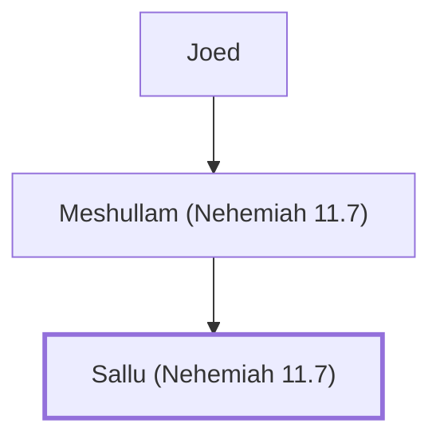

# Sallu (Nehemiah 11.7)

Benjamite who settled in Jerusalem after the exile

**Original-language names:** סַלּוּא (H5543d)

## When

- **Placed around:** [[connections/timeline/5th century BC|445 BC]] *(Ussher: the median date of the passages naming them)*

## Family

- **Father:** [[connections/people/Meshullam (Nehemiah 11.7)|Meshullam (Nehemiah 11.7)]]

**Line of descent** (8 generations, father to son): [[connections/people/Jeshaiah (Nehemiah 11.7)|Jeshaiah (Nehemiah 11.7)]] → [[connections/people/Ithiel (Nehemiah 11.7)|Ithiel (Nehemiah 11.7)]] → [[connections/people/Maaseiah (Nehemiah 11.7)|Maaseiah (Nehemiah 11.7)]] → [[connections/people/Kolaiah (Nehemiah 11.7)|Kolaiah (Nehemiah 11.7)]] → [[connections/people/Pedaiah (Nehemiah 11.7)|Pedaiah (Nehemiah 11.7)]] → [[connections/people/Joed|Joed]] → [[connections/people/Meshullam (Nehemiah 11.7)|Meshullam (Nehemiah 11.7)]] → **Sallu (Nehemiah 11.7)**

**Family group:** [[connections/genealogy/Family of Jeshaiah (Nehemiah 11.7)|Family of Jeshaiah (Nehemiah 11.7)]], generation 8

## Appears in

[[connections/chapters/16-nehemiah/Nehemiah 11|Nehemiah 11]]

## Appears in the same verse as

[[connections/people/Benjamin (Genesis 35.18)|Benjamin (Genesis 35.18)]] · [[connections/people/Ithiel (Nehemiah 11.7)|Ithiel (Nehemiah 11.7)]] · [[connections/people/Jeshaiah (Nehemiah 11.7)|Jeshaiah (Nehemiah 11.7)]] · [[connections/people/Joed|Joed]] · [[connections/people/Kolaiah (Nehemiah 11.7)|Kolaiah (Nehemiah 11.7)]] · [[connections/people/Maaseiah (Nehemiah 11.7)|Maaseiah (Nehemiah 11.7)]] · [[connections/people/Meshullam (Nehemiah 11.7)|Meshullam (Nehemiah 11.7)]] · [[connections/people/Pedaiah (Nehemiah 11.7)|Pedaiah (Nehemiah 11.7)]]
