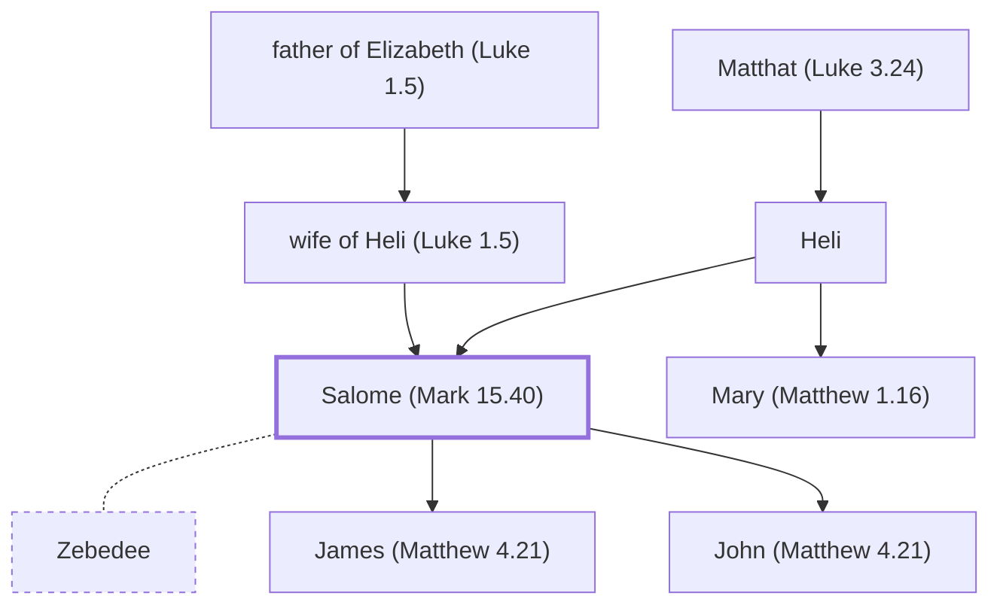

# Salome (Mark 15.40)

Witness of Jesus' crucifixion and resurrection

**Also called:** a wife of Zebedee

**Original-language names:** Σαλώμη (G4539) · . (G4539)

## When

- **Placed around:** [[connections/timeline/1st century AD|AD 33]] *(Ussher: the median date of the passages naming them)*

## Family

- **Father:** [[connections/people/Heli|Heli (uncertain)]]
- **Mother:** [[connections/people/wife of Heli (Luke 1.5)|wife of Heli (Luke 1.5) (uncertain)]]
- **Brothers and sisters:** [[connections/people/Mary (Matthew 1.16)|Mary (Matthew 1.16) (uncertain)]]
- **Spouses:** [[connections/people/Zebedee|Zebedee (uncertain)]]
- **Children:** [[connections/people/James (Matthew 4.21)|James (Matthew 4.21) (uncertain)]], [[connections/people/John (Matthew 4.21)|John (Matthew 4.21) (uncertain)]]
- **Tribe or nation:** Tribe of Levi(?)

**Line of descent** (75 generations, father to son): [[connections/people/Adam|Adam]] → [[connections/people/Seth|Seth]] → [[connections/people/Enosh|Enosh]] → [[connections/people/Kenan|Kenan]] → [[connections/people/Mahalalel (Genesis 5.12)|Mahalalel (Genesis 5.12)]] → [[connections/people/Jared|Jared]] → [[connections/people/Enoch (Genesis 5.18)|Enoch (Genesis 5.18)]] → [[connections/people/Methuselah|Methuselah]] → [[connections/people/Lamech (Genesis 5.25)|Lamech (Genesis 5.25)]] → [[connections/people/Noah (Genesis 5.29)|Noah (Genesis 5.29)]] → [[connections/people/Shem|Shem]] → [[connections/people/Arpachshad|Arpachshad]] → [[connections/people/Cainan|Cainan]] → [[connections/people/Shelah (Genesis 10.24)|Shelah (Genesis 10.24)]] → [[connections/people/Eber (Genesis 10.21)|Eber (Genesis 10.21)]] → [[connections/people/Peleg|Peleg]] → [[connections/people/Reu|Reu]] → [[connections/people/Serug|Serug]] → [[connections/people/Nahor (Genesis 11.22)|Nahor (Genesis 11.22)]] → [[connections/people/Terah|Terah]] → [[connections/people/Abraham|Abraham]] → [[connections/people/Isaac|Isaac]] → [[connections/people/Israel|Israel]] → [[connections/people/Judah (Genesis 29.35)|Judah (Genesis 29.35)]] → [[connections/people/Perez|Perez]] → [[connections/people/Hezron (Genesis 46.12)|Hezron (Genesis 46.12)]] → [[connections/people/Ram (Ruth 4.19)|Ram (Ruth 4.19)]] → [[connections/people/Amminadab (Exodus 6.23)|Amminadab (Exodus 6.23)]] → [[connections/people/Nahshon|Nahshon]] → [[connections/people/Salmon|Salmon]] → [[connections/people/Boaz|Boaz]] → [[connections/people/Obed (Ruth 4.17)|Obed (Ruth 4.17)]] → [[connections/people/Jesse|Jesse]] → [[connections/people/David|David]] → [[connections/people/Nathan (2 Samuel 5.14)|Nathan (2 Samuel 5.14)]] → [[connections/people/Mattatha|Mattatha]] → [[connections/people/Menna|Menna]] → [[connections/people/Melea|Melea]] → [[connections/people/Eliakim (Luke 3.30)|Eliakim (Luke 3.30)]] → [[connections/people/Jonam|Jonam]] → [[connections/people/Joseph (Luke 3.30)|Joseph (Luke 3.30)]] → [[connections/people/Judah (Luke 3.30)|Judah (Luke 3.30)]] → [[connections/people/Simeon (Luke 3.30)|Simeon (Luke 3.30)]] → [[connections/people/Levi (Luke 3.29)|Levi (Luke 3.29)]] → [[connections/people/Matthat (Luke 3.29)|Matthat (Luke 3.29)]] → [[connections/people/Jorim|Jorim]] → [[connections/people/Eliezer (Luke 3.29)|Eliezer (Luke 3.29)]] → [[connections/people/Joshua (Luke 3.29)|Joshua (Luke 3.29)]] → [[connections/people/Er (Luke 3.28)|Er (Luke 3.28)]] → [[connections/people/Elmadam|Elmadam]] → [[connections/people/Cosam|Cosam]] → [[connections/people/Addi|Addi]] → [[connections/people/Melchi (Luke 3.28)|Melchi (Luke 3.28)]] → [[connections/people/Neri|Neri]] → [[connections/people/Shealtiel (Luke 3.27)|Shealtiel (Luke 3.27)]] → [[connections/people/Zerubbabel (Luke 3.27)|Zerubbabel (Luke 3.27)]] → [[connections/people/Rhesa|Rhesa]] → [[connections/people/Joanan|Joanan]] → [[connections/people/Joda|Joda]] → [[connections/people/Josech|Josech]] → [[connections/people/Semein|Semein]] → [[connections/people/Mattathias (Luke 3.26)|Mattathias (Luke 3.26)]] → [[connections/people/Maath|Maath]] → [[connections/people/Naggai|Naggai]] → [[connections/people/Esli|Esli]] → [[connections/people/Nahum (Luke 3.25)|Nahum (Luke 3.25)]] → [[connections/people/Amos (Luke 3.25)|Amos (Luke 3.25)]] → [[connections/people/Mattathias (Luke 3.25)|Mattathias (Luke 3.25)]] → [[connections/people/Joseph (Luke 3.24)|Joseph (Luke 3.24)]] → [[connections/people/Jannai|Jannai]] → [[connections/people/Melchi (Luke 3.24)|Melchi (Luke 3.24)]] → [[connections/people/Levi (Luke 3.24)|Levi (Luke 3.24)]] → [[connections/people/Matthat (Luke 3.24)|Matthat (Luke 3.24)]] → [[connections/people/Heli|Heli]] → **Salome (Mark 15.40)**

**Family group:** [[connections/genealogy/Family of Adam|Family of Adam]], generation 75

## Events

- [[connections/timeline/1st century AD|AD 30]] · [[connections/events/Resurrection and Ascension|Resurrection and Ascension]]
- [[connections/timeline/1st century AD|AD 30]] · [[connections/events/Crucifixion and Burial|Crucifixion and Burial]]

## Appears in

[[connections/chapters/41-mark/Mark 15|Mark 15]] · [[connections/chapters/41-mark/Mark 16|Mark 16]]

## Appears in the same verse as

[[connections/people/James (Matthew 10.3)|James (Matthew 10.3) (2)]] · [[connections/people/Mary (Matthew 27.56)|Mary (Matthew 27.56) (2)]] · [[connections/people/Mary Magdalene|Mary Magdalene (2)]] · [[connections/places/Magadan|Magadan (2)]] · [[connections/people/Joses (Matthew 27.56)|Joses (Matthew 27.56)]]
